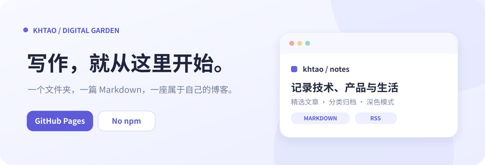
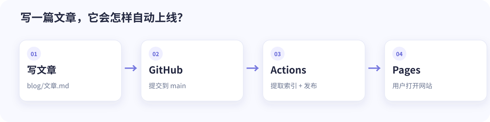

<p align="center"></p>

<p align="center"><strong>把想法写成 Markdown，把它们留在自己的互联网角落。</strong></p>

<p align="center">一个轻量、好看、容易维护的个人博客模板。保留写作的简单，也认真对待浏览体验。</p>

<p align="center">
<a href="https://khtao.github.io/#/">✨ 在线预览</a> ·
<a href="blog/从零部署%20Khtao%20Blog%203.0.md">📖 图文部署教程</a> ·
<a href="https://github.com/khtao/khtao.github.io">🗂 源码仓库</a> ·
<a href="https://github.com/khtao/khtao.github.io/issues">🐛 反馈建议</a>
</p>

<p align="center"><strong>无需 npm 构建 · 支持 Markdown / HTML · 自动更新 · GitHub Pages 部署</strong></p>

---

## 👀 先看看它长什么样

<table>
  <tr>
    <td width="73%" align="center"><br/><b>桌面端 · 编辑式双栏布局</b></td>
    <td width="27%" align="center"><br/><b>移动端 · 自适应阅读</b></td>
  </tr>
</table>

<details>
<summary>🌙 展开查看深色模式</summary>


</details>

> 预览图展示的是模板的示例文章。替换 `config.json` 与 `blog/` 中的内容后，这里就会成为你的博客。

## ✨ 让写作回归简单

| 你想要的 | Khtao Blog 怎么做 |
|---|---|
| 🎨 好看的个人主页 | 蓝紫色视觉语言、精选文章、作者侧栏、浅色／深色主题 |
| ✍️ 打开就写 | 放入 `.md` 或 `.html`，无需为每篇文章手写标题、摘要、日期 |
| 🧭 内容有条理 | 文章搜索、标签、分类、按年归档、最近发布／修订排序 |
| 📖 读得舒服 | 文章目录、代码高亮、字号调节、前后篇导航、复制分享链接 |
| 📱 随时随地 | 桌面、平板和手机响应式布局，支持键盘快捷搜索 `Ctrl/⌘ + K` |
| 📡 方便订阅 | 自动生成 RSS (`feed.xml`) 以及基础站点地图 |
| 🚀 更新不费力 | 提交文章后，GitHub Actions 构建索引并发布到 GitHub Pages |
| 🔒 不怕 API 限流 | 访客直接读取本站 `blog/index.json`，不依赖 GitHub Contents API |

**技术选择很克制：** 一个 `index.html` + `config.json` + Python 标准库索引生成器 + GitHub Actions。无需引入 Hexo、Jekyll、Astro 或 npm 构建链；浏览器展示 Markdown 时可使用 CDN 渲染库，并提供基础降级渲染。

## 🚀 现在开始，给自己搭一座博客



### 方式 A：使用 GitHub 模板（如果仓库显示「Use this template」）

1. 进入 [Khtao Blog 仓库](https://github.com/khtao/khtao.github.io)，点击 **Use this template → Create a new repository**。
2. 仓库名填写 **`YOUR_USERNAME.github.io`**，其中 `YOUR_USERNAME` 替换为你自己的 GitHub 用户名，选择 Public。
3. 打开 `config.json`，把 `owner`、`author`、`repo`、博客标题与介绍改成自己的信息。
4. 在新仓库 **Settings → Pages → Build and deployment → Source** 选择 **GitHub Actions**。
5. 在 **Actions** 查看 `Build and deploy blog`。必要时通过 **Run workflow** 手动触发首次部署。
6. 成功后访问 `https://YOUR_USERNAME.github.io/#/`。

**没有「Use this template」按钮？** 这意味着仓库可能尚未启用模板模式，直接使用下方方式 B 即可。仓库维护者可在 **Settings → General → Template repository** 开启模板功能。

### 方式 B：下载源码并上传（始终可用）

1. 在 [仓库页面](https://github.com/khtao/khtao.github.io) 选择 **Code → Download ZIP**，解压。
2. 在你的 GitHub 账号新建公开仓库 **`YOUR_USERNAME.github.io`**。
3. 把解压后**仓库根目录内**的文件和文件夹上传到新仓库根目录，特别注意保留 `.github/workflows/blog-index.yml`、`scripts/build_index.py`、`blog/`。
4. 修改 `config.json`、按上面的 Pages 设置部署。使用 Git 或 GitHub Desktop 提交整个目录通常最不容易遗漏隐藏文件。


## 📝 发第一篇文章：真的只需要 Markdown

在 `blog/我的第一篇文章.md` 新建文件：

```md
# 我的第一篇文章

今天，我终于有了一个真正属于自己的博客。

## 从这里开始

以后把学到的、做过的、想明白的，都慢慢写下来。
```

提交到 `main` 后，工作流会自动提取标题、摘要、首次提交日期与最近修订日期；文章索引、RSS 和页面一起发布。你无需去 GitHub API 查询文章列表。

想加分类和标签？在文章最前面**可选**地写：

```yaml
---
category: 技术
tags: [GitHub Pages, 博客]
---
```

> 完全不写头信息也能正常发布；添加时请让 `category`、`tags` 等字段保持顶格对齐。

插入图片时，可把图片放进 `blog/images/`，正文用 ``；页面会自动将资源地址指向博客目录。

## 🗂 项目结构，一眼看懂

```text
YOUR_USERNAME.github.io/
├── index.html                    # 页面、样式、文章阅读器
├── config.json                   # 博客名称、简介和作者信息
├── blog/
│   ├── 我的第一篇文章.md          # 你的内容
│   ├── images/                   # 图片与教程插图
│   └── index.json                # 自动生成的文章索引
├── scripts/
│   └── build_index.py            # 提取元数据、生成 RSS / sitemap
├── .github/
│   └── workflows/
│       └── blog-index.yml       # 自动部署到 GitHub Pages
└── .nojekyll                     # 静态站点兼容文件（构建时也会自动创建）
```

### 个性化入口

修改 `config.json` 就能调整 `title`、`subtitle`、`description`、`author`、`owner`、`repo`、`notice`、`about`。需要改配色或页面布局时，编辑 `index.html` 内的 CSS 即可。**请把 `owner` 与 `repo` 改成你的 GitHub 账号和实际仓库名称。**

## 🧩 它是如何工作的？

```text
你新建、编辑或删除 blog/ 中的文章
                ↓
       Push / Commit 到 main
                ↓
     GitHub Actions 获取 Git 历史
                ↓
Python 生成 blog/index.json + feed.xml + sitemap.xml
                ↓
   与 index.html、blog/ 同步部署到 Pages
                ↓
        读者访问你的网站
```

- 文章删除后索引会同步变化；即使删除最后一篇文章，也会正常展示空状态。
- Git 首次／最后提交时间用于计算发布和更新日期（若无历史记录，则使用可用的日期信息）。
- 目前使用 `#/` 路由；站点地图只包含主页，**不等同于每篇文章都拥有独立的 SEO 页面**。
- 一些增强型 Markdown 排版效果依赖外部 CDN；基础页面、索引与部署不需要调用 GitHub API。

## 🔧 本地预览与检查

```bash
python3 scripts/build_index.py
python3 -m http.server 8000
```

打开 `http://localhost:8000/#/`。如下载的源码包含 `tests/`，可运行 `python3 -m unittest discover -s tests -v`。

请通过 HTTP 访问而不是双击使用 `file://` 打开，因为浏览器会限制本地文件的 `fetch` 行为。

## 💬 反馈、灵感与下一步

喜欢这种**低维护、重内容**的博客方式？欢迎给仓库点一个 ⭐ Star，或者在 [Issues](https://github.com/khtao/khtao.github.io/issues) 留下你的作品、建议或问题。

也欢迎直接阅读 [图文部署教程](blog/%E4%BB%8E%E9%9B%B6%E9%83%A8%E7%BD%B2GitHub%E5%8D%9A%E5%AE%A2.md))，从第一篇文章开始记录。

> **关于授权**：仓库公开不等于自动授予再分发权。维护者建议补充明确的 `LICENSE`（例如 MIT），让想要使用、修改和传播模板的人安心使用；发布前请以仓库实际许可为准。

<div align="center"><sub>Built with GitHub Pages · Made for writing, not configuration.</sub></div>
