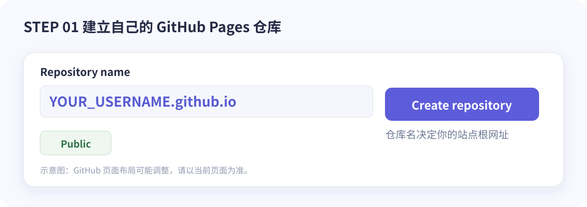
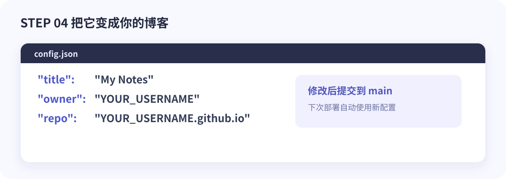
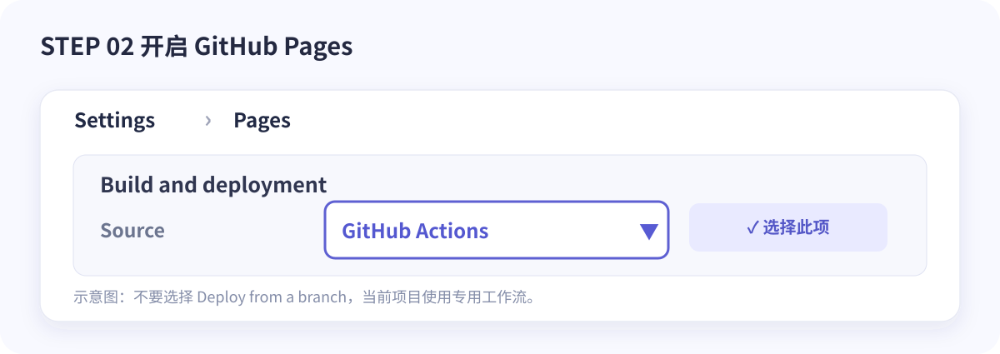
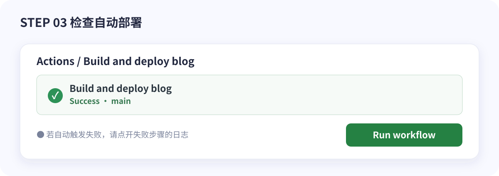

# 从零部署博客：让 GitHub 自动变成你的个人网站

想拥有一个真正属于自己的博客，却不想为了写一篇文章先学会一套复杂的前端构建流程？这篇教程带你从零部署博客：不用购买服务器，基本不需要写前端代码；以后只要把 Markdown 放进 `blog/`，GitHub Actions 就能帮助你发布。


**先看最终效果：** [Khtao Blog 在线演示](https://khtao.github.io/#/) · [GitHub 源码](https://github.com/khtao/khtao.github.io)


你会得到一个带有**文章精选、个人侧栏、搜索、标签、分类、归档、深浅色模式和 RSS** 的博客；手机访问时，布局也会自动调整。文章无需强制填写 YAML 头信息，标题、摘要和 Git 提交日期都可以自动提取。

## 01 · 先搞清楚：这套博客为什么容易维护？

一句话：**让 GitHub 保存内容，让 Actions 整理内容，让 Pages 发布内容。**


和需要数据库的传统博客不同，这套方案主要使用以下文件：`index.html` 负责界面，`config.json` 负责基础设置，`blog/` 保存文章，而 `scripts/build_index.py` 负责生成文章目录。访问者读取的文章索引位于本站的 `blog/index.json`，**不需要浏览器实时访问 GitHub API**。

> **准备清单：** 一个 GitHub 账号；浏览器；可选的 Git 或 GitHub Desktop。GitHub Pages 对公开仓库提供网站托管。本文演示使用仓库 `YOUR_USERNAME.github.io`，请将 `YOUR_USERNAME` 替换成**你自己的 GitHub 用户名**。

## 02 · 获得项目源码，创建仓库

打开 [Khtao Blog 源码仓库](https://github.com/khtao/khtao.github.io)。

**方式一：模板创建。** 如果仓库顶部有 **Use this template**，选择 **Create a new repository**。这会把项目文件复制到你的新仓库。若该按钮尚未出现，说明维护者可能没有开启 Template repository，可以用下面的方式二。

**方式二：下载源码。** 点击 **Code → Download ZIP**，解压后，在你的 GitHub 账号里创建新仓库，再上传源码。推荐使用 GitHub Desktop 或 Git 提交解压后的所有文件，避免漏掉 `.github` 这样的隐藏目录。

仓库名建议**严格使用 `YOUR_USERNAME.github.io`**，并选择 Public。用户／组织 Pages 根站点的仓库名称需要与账号名称对应。



**注意 3 个小坑：** 不要把 `khtao-blog-3.0/` 这个解压文件夹整体多套一层；不要漏掉 `.github/workflows/blog-index.yml`；不要把仓库命名为别人的用户名。项目型 Pages 也能部署，但第一次使用建议从个人根站点开始，路径最清晰。

## 03 · 修改配置，给博客换上你的名字

进入仓库的 `config.json`。至少改动以下字段：

```json
{
  "title": "我的数字花园",
  "subtitle": "记录生活、技术与好奇心",
  "description": "把值得记住的事留在这里。",
  "author": "YOUR_USERNAME",
  "owner": "YOUR_USERNAME",
  "repo": "YOUR_USERNAME.github.io",
  "branch": "main",
  "blogDir": "blog"
}
```

上面是**需要修改的字段示例**；实际编辑时建议保留项目原有 `config.json` 中的其他设置。`owner` 和 `repo` 需要与你刚刚创建的仓库一致，`author` 和页面文案则完全由你决定。保存并提交。



如果使用自定义域名，后续还可设置 `siteUrl`；首次上线先不用改域名，减少变量。

## 04 · 开启 GitHub Pages，这是最重要的一步

在仓库页面进入 **Settings → Pages**。

在 **Build and deployment → Source** 下拉框选择 **GitHub Actions**，而不是 `Deploy from a branch`。因为这套模板需要在发布前运行 Python 脚本生成索引和 RSS。



设置完成后，转到 **Actions → Build and deploy blog**。上传文件或修改配置会触发工作流；也可以点击 **Run workflow → main → Run workflow** 手动触发一次。



看到绿色的 **Success** 才表示本次发布成功。随后打开：

- **博客首页**：`https://YOUR_USERNAME.github.io/#/`
- **文章索引**：`https://YOUR_USERNAME.github.io/blog/index.json`
- **RSS 订阅**：`https://YOUR_USERNAME.github.io/feed.xml`

不要把示例地址 `khtao.github.io` 当作你自己的站点地址。

## 05 · 真正的第一篇文章：不必写头信息

在仓库 `blog/` 目录创建 `第一篇文章.md`，输入以下内容：

```markdown
# 我的第一篇文章

今天，我终于有了一个自己的小站。这里会放下我的笔记、思考和一些有趣的实验。

## 为什么开始写作？

因为想法会忘记，记录可以让它们慢慢留下来。
```

就这样。**不用填写 `title`、`summary`、`date`、`updated`。** 提交到 `main` 后，工作流会根据文章内容以及 Git 历史生成索引。标题默认来自 Markdown 标题，摘要默认来自正文段落，发布和更新日期则尽量来自首次和最后一次提交记录。

如果想让文章有分类、标签和封面，可以**自愿**在最顶部添加：

`category`、`tags` 和 `cover` 应保持顶格对齐，完整写法如下：

```yaml
---
category: 技术
tags: [笔记, 开发]
cover: images/guide/hero.svg
---
```

示例中的 `hero.svg` 是本模板带的插图，你也可以换成自己的图片。添加新文章以后，去 Actions 看一次是否部署成功即可。

## 06 · 为文章添加图片，也让博客「图文并茂」

把 `旅行照片.webp` 放到 `blog/images/`，然后在 Markdown 里写：

```markdown

```

这里的路径是**相对于 `blog/` 文件夹**的，不要写本地电脑上的 `C:\...` 路径。推荐使用 WebP 或经过压缩的 PNG / JPEG；图片有清晰的替代文字（`alt`）也方便阅读。

想看看不同设备上的效果？下面是模板的真实手机预览：


文章也支持直接上传 `.html` 文件，适合展示有自定义 CSS 的完整页面。HTML 文章会采用独立的 iframe 阅读方式。

## 07 · 删除、修改、更新：日常维护其实很简单

以后你只需要关心 `blog/`：

1. **新增文章**：上传新的 `.md` 或 `.html` 并提交；
2. **修改文章**：编辑正文并提交，索引自动刷新更新日期；
3. **删除文章**：删除文件并提交，索引会去掉对应条目；
4. **全部删空**：首页显示正常空状态，不会因为索引为空而回退访问 GitHub API。

修改 `index.html`、`config.json`、索引脚本或工作流，同样会触发重新部署。单独修改仓库 README 不会触发这份工作流，因为 README 不是站点产物。

想在电脑上本地看效果，打开终端到项目根目录：

```bash
python3 scripts/build_index.py
python3 -m http.server 8000
```

然后访问 `http://localhost:8000/#/`。不要双击以 `file://` 打开，否则浏览器可能阻止读取本地 JSON。

## 08 · 常见问题：走过的弯路，都给你整理好了

| 遇到什么问题 | 优先检查哪里 |
|---|---|
| **Startup failure：`actions/checkout... not allowed`** | `Settings → Actions → General` 的 **Actions permissions**。需要允许运行 GitHub 官方提供的 Actions；不要设置为仅允许运行自己仓库的 Actions。 |
| **Queued 一直排队** | 先确认 Actions 是否启用、是否有未结束的运行。`Queued` 不是 Python 脚本已经运行失败。 |
| **Process completed with exit code 1** | 打开失败运行，展开第一个标红的**具体步骤及日志**，只看注释汇总无法定位根因。 |
| **Node.js / Ubuntu 迁移警告** | 警告本身不等于失败。此版本工作流使用 `actions/checkout@v5` 和 `ubuntu-24.04`。 |
| **首页 404** | 检查仓库名字是否为 `YOUR_USERNAME.github.io`、Pages 的 Source 是否选 GitHub Actions、工作流是否成功。 |
| **索引读不到或文章删除后还显示** | 直接打开 `/blog/index.json` 查看是否包含 `files` 数组；确认最近一次部署完成，必要时强制刷新。 |
| **`.nojekyll` 缺失** | 3.0 工作流会用 `touch _site/.nojekyll` 自动创建，不必手工上传。 |
| **图片不显示** | 核对图片已提交到 `blog/images/`，Markdown 使用 `images/文件名` 这种相对路径并注意大小写。 |

> 重要：博客本身运行在 GitHub Pages 上；如果用户网络连不上 GitHub Pages，静态网站同样无法访问。这与 GitHub API 限流是不同的问题。

## 09 · 让它慢慢成为你的作品

上线只是第一步。你可以换掉首页介绍、给文章写更好的开头、整理技术笔记，也可以记录生活琐事。分类和标签会随着文章自然生长；有人通过 RSS 订阅，你的新文章就多了一种被看见的方式。


如果你想把博客做成自己的模板，可以继续调整 `index.html` 的配色和布局。它最大的优点不是功能有多复杂，而是让你**想写的时候，真的可以立刻开始写**。

**最后，欢迎回来分享你的作品：** [Khtao Blog GitHub 仓库](https://github.com/khtao/khtao.github.io) · [在线演示](https://khtao.github.io/#/) · [GitHub Pages 官方文档](https://docs.github.com/en/pages/getting-started-with-github-pages/configuring-a-publishing-source-for-your-github-pages-site)

---

*注：文中的博客页面截图来自示例站的本地测试环境；GitHub 仓库创建、Pages 设置和 Actions 页面图片是操作示意图，不是 GitHub 网站的实时截图。界面可能随官方更新而变化。*
