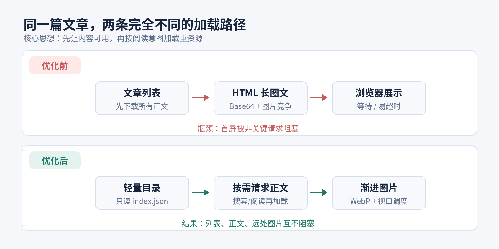
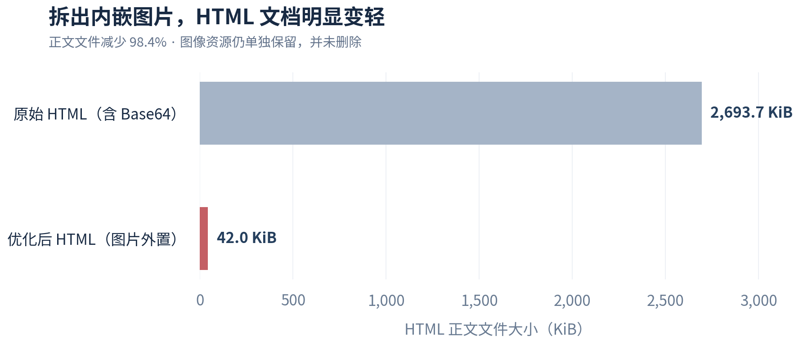
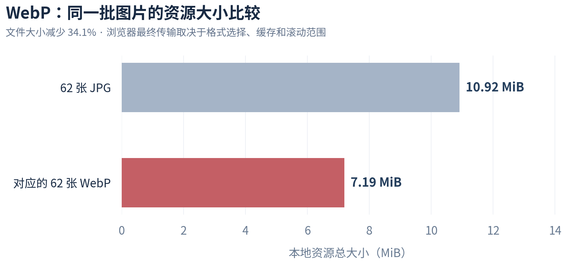
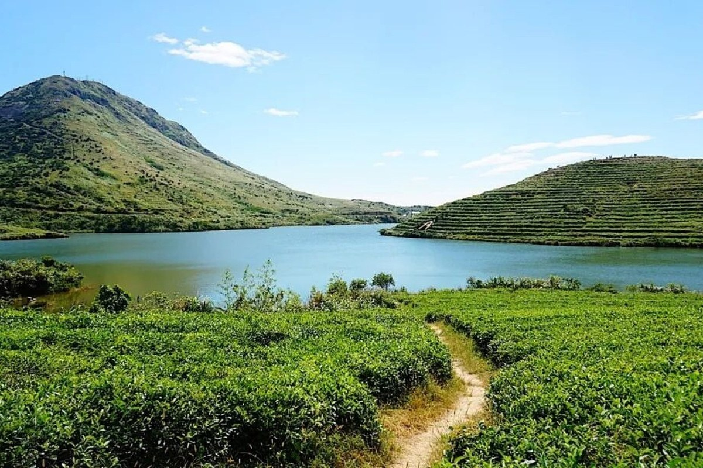
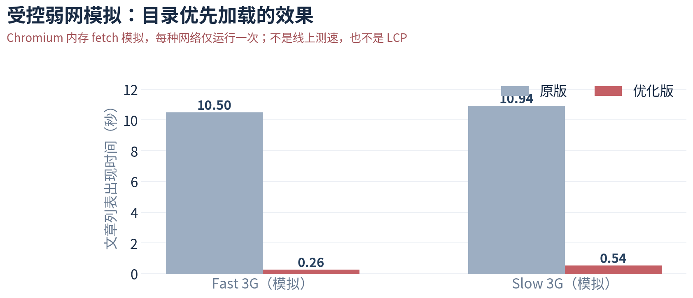

# 博客网站性能优化实战

一篇图文博客打开得慢，真的是“服务器不够快”吗？对于静态网站，问题往往不在服务器，而在**资源什么时候被请求、哪些请求抢占了首屏带宽、失败后能不能优雅恢复**。

本文以 [Khtao Blog](https://khtao.github.io/#/) 及其 [GitHub 开源仓库](https://github.com/khtao/khtao.github.io) 为案例，复盘这次优化中遇到的实际问题：文章列表被正文拖慢、HTML 内嵌图片过大、长文 iframe 中懒加载失效、网络抖动时页面无反馈，以及重复构建和缓存策略的取舍。下文结合架构图、源码节选、文件体积对比和测试方法，分享可迁移到其他博客的思路。


## 1. 先把加载过程拆开

Khtao Blog 是 GitHub Pages 上的轻量静态站点：首页由 `index.html` 运行，文章存放在 `blog/`，GitHub Actions 用 Python 构建文章索引、搜索索引及图片衍生资源，部署时把静态文件打包发布。



优化的核心并不是“让所有文件都加载得更快”，而是**让用户当前需要的部分先出现**。首页用户需要的是标题、日期、摘要；点进文章才需要正文；只有滚动到图片附近，才需要那张图片。

因此可以把资源分成三个层级：

- **立即必需**：页面框架、文章目录、当前可见的封面或首图。
- **交互后必需**：Markdown / HTML 正文、全文搜索索引、代码高亮。
- **滚动后才必需**：长图文中的远处图片、灯箱用的原始大图。

### 从“列表等待正文”到“目录优先”

旧方案会并发获取文章全文后再完成列表展示。遇到包含大量图片的 HTML，哪怕用户只想浏览标题，也要为整篇文章的请求付出等待成本。

优化后，`blog/index.json` 只包含首页卡片需要的元数据，页面拿到索引便可以渲染；打开 Markdown 时再获取对应正文。以下代码保留了实际实现中的关键思想，省略了错误处理与状态管理：

```javascript
// 首页：先拿元数据，直接显示文章列表
const index = await fetch('blog/index.json', { cache: 'no-store' })
  .then(r => r.json());
renderPostCards(index.files);

// 阅读：只有进入具体文章才请求正文
async function openMarkdown(post) {
  const url = `${post.path}?v=${encodeURIComponent(post.sha)}`;
  const text = await fetch(url, { cache: 'default' }).then(r => r.text());
  renderMarkdown(text);
}
```

这里 `sha` 用作内容版本号：**文章没改动时，URL 不变，浏览器可以复用正文缓存；文章更新后，URL 改变，旧正文不再被错误使用。** 而目录每次尝试获取新版本，避免文章列表长期过期。

还需要兼顾全文搜索：本站将正文搜索数据另放在 `blog/search-index.json`，用户开始搜索时才读取。这样不为了首页加载速度牺牲 HTML 和 Markdown 的全文检索能力。

## 2. 把“大 HTML 文件”拆成“正文 + 图片”

最典型的案例是一篇《郴州中秋自驾》HTML 游记。早期文件把12张图片直接写成 Base64 数据，导致**一个 HTML 文件约2,758,361字节**。HTML 正文和图片绑在一起，浏览器无法按图片可见性决定是否下载：哪怕用户只看开头，也需要取得包含大量内嵌图片的数据。

优化时先把内嵌图片提取成独立的 JPG / WebP 文件，再用相对路径引用。第五轮源码中，这篇 HTML 约 **42,993字节**，文本文件比最初缩小约 **98.4%**。



**注意：减少的是 HTML 文档体积，不是整篇游记的全部图片数据凭空消失了。** 图片仍保留，只是可以单独缓存、压缩、延迟加载。它也意味着后续修改一段文字，不必把所有内嵌图片重新传一遍。

改造前后可以理解为：

```html
<!-- 之前：HTML 中直接嵌入整张图片（示意） -->


<!-- 之后：正文只保留一个图片引用 -->

```

## 3. WebP 压缩：降低字节数，但不牺牲回退路径

在构建阶段，`scripts/optimize_images.py` 使用 Pillow 为 JPG 生成同名 `.webp` 文件，并保留原图作为兼容性与灯箱回退。源码配置的 WebP 质量约为76，长边上限为1600像素；同时用 SHA-256 记录输入文件与处理设置，避免在同一份构建工作区里反复压缩未修改文件。

对第五轮源码内**同名成对的62张照片**实际统计，JPG 合计约 **10.92 MiB**，对应 WebP 合计约 **7.19 MiB**，相当于文件大小减少 **34.1%**。



处理脚本的核心形式如下（简化示例）：

```python
from pathlib import Path
from PIL import Image, ImageOps

for source in Path('blog/images').rglob('*.jpg'):
    with Image.open(source) as img:
        img = ImageOps.exif_transpose(img)
        img.thumbnail((1600, 1600))
        img.save(source.with_suffix('.webp'), 'WEBP', quality=76, method=5)
```

浏览器端则优先尝试 WebP，**只有 WebP 请求失败才回退到 JPG**；不能让失败的优化路径变成图片永久不显示：

```javascript
function revealPhoto(img, originalUrl) {
  const webpUrl = originalUrl.replace(/\.(jpg|jpeg|png)$/i, '.webp');
  img.addEventListener('error', function fallback() {
    img.removeEventListener('error', fallback);
    if (img.src.endsWith('.webp')) img.src = originalUrl;
  });
  img.src = webpUrl;
}
```

实际站点还有格式支持检测和目录级失败记录，以上只展示最容易迁移的逻辑。需要注意：**仓库里同时存 JPG 和 WebP，磁盘占用会增加；但用户通常只下载其中一种格式，并不等于访问一次就下载两套。**

## 4. 为什么 `loading="lazy"` 在长篇 iframe 中可能失效？

这是本次优化最有代表性的坑。Khtao Blog 为保持 HTML 文章自带的 CSS 和 JavaScript，使用同源 iframe 阅读。为了使文章与站点滚动连贯，外层页面可能把 iframe 高度设置为整篇内容高度。

如果只在文章中添加：

```html

```

浏览器判断图片是否接近视口时，可能受到**巨大 iframe 视口**的影响，导致本应在文章后半段才出现的图片也提前加入请求队列。尤其是在慢速 3G 下，大量非首屏图片会争夺首图与正文所需的带宽。

### 更稳健的办法：在 HTML 被解析之前暂存真实地址

本项目新增 `scripts/prepare_html_lazy.py`：构建时保留首两张图片的正常 `src`，对其余图片写入轻量占位和 `data-khtao-src`。这种做法的关键是：**浏览器在解析 HTML 时根本拿不到远处图片的真实 URL，自然不会提前发出请求。**

```html
<!-- 构建产物示意；占位图是透明 1×1 GIF -->

```

之后再按阅读方式分流：

- **单独打开 HTML 文件**：文章内的 `IntersectionObserver` 在图片接近可视区域时恢复真实地址，优先加载 WebP。
- **通过博客首页打开 iframe**：由父页面根据**外层滚动位置**控制释放图片 URL，避免 iframe 内部高度误判。
- **接管异常**：如果父页面始终无法初始化，文章内的备用机制会在延迟后接手，不让下方图片永久停留在占位状态。

独立打开模式的简化代码：

```javascript
const observer = new IntersectionObserver(entries => {
  for (const entry of entries) {
    if (!entry.isIntersecting) continue;
    const img = entry.target;
    observer.unobserve(img);
    const original = img.dataset.khtaoSrc;
    img.removeAttribute('data-khtao-src');
    revealPhoto(img, original);
  }
}, { rootMargin: '850px 0px' });

document.querySelectorAll('img[data-khtao-src]')
  .forEach(img => observer.observe(img));
```

这段代码仅对应独立页面；**不能直接把它搬进被整篇撑高的 iframe 并期望相同行为**。站内阅读还必须结合外层页面滚动坐标。第五轮源码进一步修正了父页面接管过慢时的竞争：在受控8图场景、父页面延迟2.35秒的测试中，旧版提前放行8张，新版为0张；这同样属于本地故障注入测试，不是线上资源瀑布。

此外，为每张图填入准确的 `width`、`height` 或 `aspect-ratio`，能让浏览器在图片下载前预留高度，减少长文滚动时的布局跳动。

## 5. 缓存优先，但不要把全文都塞进浏览器

本站同时使用两层不同的缓存：

1. **`localStorage` 保存文章目录及少量 Markdown 正文**：回访时先展示已有文章卡片，再后台同步最新目录。存储配额不足时，退化为只缓存元数据，不影响正常访问。
2. **HTTP 缓存保存文章和图片**：正文 URL 带内容指纹，目录请求使用 `no-store`，图片尺寸表可以使用浏览器缓存。

代码里还特别防止一个容易忽视的体验问题：后台定时刷新如果发现文章列表没有变化，就不应重绘整个页面。否则正在阅读的 HTML iframe 会被重新创建，读者突然回到文章顶部。

```javascript
const before = postsSignature();
const latest = await fetchIndex();
updatePostMetadata(latest);

// 数据内容没有变化，就保留现有 DOM 和 iframe
if (postsSignature() !== before) {
  saveMetadataCache();
  render();
}
```

断网时若有缓存则显示旧目录，并明确告知正在离线浏览；网络恢复后自动同步。**这不是完整的离线阅读系统**：只有之前实际缓存过的正文或图片才可能离线读取，不能保证全部文章在无网络时可用。

## 6. 第三方依赖与 GitHub Actions：让构建做重活

为了减少访问时对外部 CDN 的依赖，Markdown 渲染器 `marked` 与代码高亮库 `highlight.js` 已放入 `assets/vendor/`。Markdown 阅读器优先使用本站脚本；代码高亮则作为非关键增强能力延后加载。渲染器本身仍有失败降级策略，保证网络不佳时文章至少可以阅读。

图片解码、提取 HTML 内嵌数据、记录宽高、生成目录与全文搜索索引，均尽量放在 GitHub Actions 的**构建阶段**完成：

```yaml
# 工作流关键步骤（示意，省略其他部署步骤）
- run: python3 scripts/extract_inline_images.py
- run: python3 scripts/optimize_images.py
- run: python3 scripts/image_sizes.py
- run: python3 scripts/prepare_html_lazy.py
- run: python3 scripts/build_index.py
- uses: actions/upload-pages-artifact@v3
  with:
    path: _site
```

生成的 WebP 保存在发布产物的 `blog/images/` 下；构建期处理账本 `.optimized.json` 不需要对读者发布。要注意，**若构建账本与生成资源没有持久化到下一次 Actions 运行，跨运行并不能凭幂等逻辑自动跳过所有转码**。因此还应控制无意义的高频重新部署，并检查 Pages Artifact 的保留期。

## 7. 优化是不是有效？怎样不把模拟数据说成实测

为验证“目录优先”是否解决了前端阻塞链路，曾用 Chromium 执行网站 JavaScript，并使用内存 `fetch` 模拟不同带宽、往返延迟和请求大小，比较原逻辑与优化逻辑：



| 条件 | 原版列表出现 | 优化版列表出现 |
| --- | ---: | ---: |
| Fast 3G（1.6 Mbps、150ms RTT） | 10.50 s | 0.26 s |
| Slow 3G（0.75 Mbps、420ms RTT） | 10.94 s | 0.54 s |

**解读边界必须讲清楚**：各条件只运行了一次；模拟使用的原版内容里还含有过时索引和大 HTML，部分请求受到10秒超时限制；没有真实 DNS、TLS、CDN、TCP 重传和设备差异。这张图只能说明拆分请求的设计显著减少了**模拟条件下的等待**，不能推导出线上提高了多少倍，更不能当作 LCP。

对于真实网站，至少需要同环境重复测量以下指标：

| 指标 | 关注什么 | 预期受益的优化 |
| --- | --- | --- |
| LCP | 首屏最大内容何时出现 | 目录优先、首图优先、控制带宽竞争 |
| CLS | 图片加载是否让正文跳动 | 图片宽高与宽高比预留 |
| INP | 搜索、切换与交互是否卡顿 | 减少无意义的重绘、延后增强脚本 |
| 请求数/传输量 | 首屏是否误拉远处图片 | `data-khtao-src`、WebP、按需请求 |
| 失败恢复率 | 离线、超时、图片404后的表现 | 缓存回退、重试、JPG 回退 |

浏览器开发工具的 **Network → Disable cache / Throttling** 可以快速定位问题；正式比较还应使用相同浏览器、测试地点和网络条件，多次记录中位数与较慢分位，而不是只截一张最快的截图。

## 8. 这次优化最值得记住的五条原则

**第一，用户不需要的内容不进入关键路径。** 首页取目录，点击文章才加载正文，开始搜索才加载全文索引。

**第二，图片的加载时机有时比压缩率更重要。** WebP 降低字节数；真正阻止58张远处图片抢带宽的是解析前暂存 URL 和正确的视口调度。

**第三，缓存要有边界和失效策略。** 目录保持新鲜、正文使用内容版本号，存储不足时能降级，刷新不能打断阅读。

**第四，兼容性与错误恢复属于性能体验的一部分。** WebP 失败能回退 JPG；iframe 初始化失败不会使文章下半部分永远看不到；断网能保持已有目录。

**第五，任何“提速了多少倍”都必须附测试条件。** 文件体积变化可以精确统计；受控模拟用于证明设计原理；真实线上体验则需要独立的浏览器网络验收。

真正好的博客性能优化，不是让测试分数漂亮，而是让读者在信号较差、图片较多、网络偶尔失败的时候，依然能**尽快看见内容、顺畅向下读，并在故障后继续阅读**。

