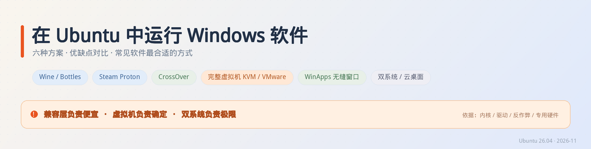
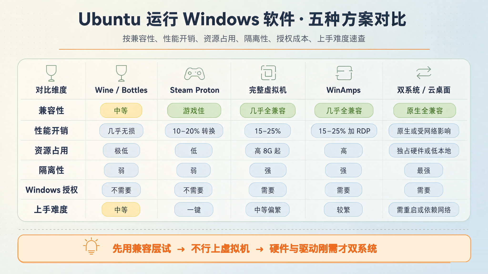
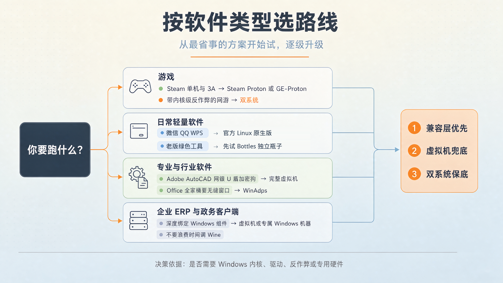

> **一句话结论**：先试兼容层（Wine / Bottles / Proton），不行再上完整虚拟机，只有内核驱动、反作弊、专用硬件这类刚需才值得双系统。
> 别一上来就装 Windows 虚拟机——它是最贵、最重的一条路，而且很多软件根本用不着。

本文环境：Ubuntu 26.04（Linux 7.0 内核）、GNOME / Wayland 桌面。文中性能数字均为**经验量级**，用于横向比较，不代表任何特定机器的实测成绩，落地前请以自己的 workload 实测为准。

---

## 一、先把问题拆对：你的软件到底依赖什么

「在 Linux 上跑 exe」听起来是一个问题，其实是四个完全不同的问题。选错方案的根源，几乎都是没搞清楚软件卡在哪一层。

| 软件依赖的东西 | 典型例子 | 翻译层能不能解决 |
|---|---|---|
| Windows 用户态 API、DLL、注册表、COM | 大多数普通桌面程序、老版绿色软件 | ✅ Wine 的主战场 |
| 图形 API（Direct3D 9/11/12） | 游戏、部分设计软件 | ✅ DXVK / VKD3D 转成 Vulkan |
| **Windows 内核驱动** | 网银 U 盾、加密狗、内核级反作弊、某些采集卡 | ❌ 翻译层加载不了内核驱动 |
| Windows 服务、组策略、激活、驱动模型 | 企业 ERP、政务客户端、部分 Adobe 套件 | ❌ 需要一套真 Windows |

Wine 不是模拟器（**W**ine **I**s **N**ot an **E**mulator），它是把 Windows API 调用实时翻译成 POSIX 调用的兼容层：程序作为宿主机上的一个普通进程运行，没有第二个内核、没有第二份系统服务、也不需要 Windows 授权。

虚拟机走的是另一条路：虚拟出 CPU、内存、磁盘、固件和外设，在里面**完整启动一个 Windows 内核**。程序看到的是真正的 Windows，包括服务、注册表、驱动栈和安全模型。

这条分界线决定了后面所有取舍：**翻译层赢在轻，虚拟机赢在真。**

---

## 二、六条路线逐一拆解

### 路线 1 · Wine + Bottles / Lutris（首选起点）

**原理**：Wine 提供 API 翻译；`WINEPREFIX`（一个包含虚拟 C 盘和注册表的目录）提供隔离环境。Bottles 和 Lutris 是图形化的「前缀管理器」，把「装运行库、切 Wine 版本、调 DXVK」这些脏活变成点几下鼠标。

截至 2026 年 11 月，WineHQ 稳定版为 **Wine 11.0**，开发版已到 11.19，11.0 把旧的 `wine` / `wine64` 两个加载器合并成了单一 `wine` 命令。

```bash
# 1) 加 WineHQ 官方源（比 Ubuntu 仓库里的版本新得多）
sudo dpkg --add-architecture i386
wget -O - https://dl.winehq.org/wine-builds/winehq.key \
  | sudo gpg --dearmor -o /usr/share/keyrings/winehq-archive-keyring.gpg
echo "deb [signed-by=/usr/share/keyrings/winehq-archive-keyring.gpg] \
https://dl.winehq.org/wine-builds/ubuntu/ $(lsb_release -cs) main" \
  | sudo tee /etc/apt/sources.list.d/winehq.list
sudo apt update
sudo apt install --install-recommends winehq-stable winetricks

# 2) 图形化前缀管理（二选一或都装）
flatpak install flathub com.usebottles.bottles      # Bottles：办公/老软件
sudo apt install lutris                            # Lutris：游戏与社区脚本
```

> **Ubuntu 26.04 的坑**：新发行版刚发布时，WineHQ 仓库常常还没有对应 codename 的目录，`apt update` 会报 404。此时要么等官方补上，要么临时把 `$(lsb_release -cs)` 换成上一个 LTS 的代号（仅作过渡），别硬改系统源文件。

**补依赖**：程序报缺 dll 时，用 `winetricks` 往指定前缀里装运行库，别装到全局：

```bash
WINEPREFIX="$HOME/.wine-myapp" winetricks corefonts vcrun2022 dotnet48 dxvk
WINEPREFIX="$HOME/.wine-myapp" wine ~/Downloads/setup.exe
```

**优点**：启动快、几乎没有额外内存开销、窗口直接融入 Linux 桌面、不需要 Windows 授权、剪贴板与文件系统天然互通。
**缺点**：兼容性**逐软件**决定，两极分化；中文输入法、字体渲染、托盘图标容易出小毛病；内核驱动、反作弊、加密狗基本没戏；一个前缀装多个软件容易 DLL 覆盖互相污染。

**适合**：一两个轻量工具、老版绿色软件、不碰硬件的桌面程序。

---

### 路线 2 · Steam Proton / GE-Proton（游戏专线）

**原理**：Proton 是 Valve 在 Wine 基础上为游戏打包的兼容层，内置 DXVK（D3D 9/10/11 → Vulkan）、vkd3d-proton（D3D 12 → Vulkan）和一堆针对具体游戏的修复。Steam 里只需：

> 库 → 右键游戏 → 属性 → 兼容性 → 勾选「强制使用特定 Steam Play 兼容性工具」→ 选 Proton 版本

非 Steam 游戏也能以「添加非 Steam 游戏」的方式挂进 Proton；排查问题先看 [ProtonDB](https://www.protondb.com/) 的社区报告，再决定是换 Proton Experimental、退版本，还是上 GE-Proton。

**GE-Proton 的两个常见误区**：

- 它不是「更好的 Wine 超集」，而是面向 Steam 的容器化构建，**脱离 Steam 直接跑不受支持**（Lutris / Heroic 走 `umu` 才能用）。
- 它不一定全面优于官方 Proton。媒体补丁是常驻收益，而 NTSync 需要较新内核（6.14+），FSR 只对走 Vulkan 的游戏生效。默认先用官方稳定版，有明确的兼容性报告推荐时再换 GE。

```bash
flatpak install flathub net.davidotek.pupgui2      # ProtonUp-Qt，图形化装 GE-Proton
```

**优点**：游戏场景几乎零配置，3D 图形转换成熟，帧率在很多单机大作上接近甚至偶尔优于 Windows。
**缺点**：只服务游戏（办公/行业软件别用它）；带内核级反作弊的网游仍是硬伤；不同 Proton 版本对同一款游戏表现可能差很多，需要试。

---

### 路线 3 · CrossOver（商业 Wine）

CodeWeavers 把 Wine 打包成带技术支持和一键安装脚本的商业产品，对 Office、部分 Adobe 老版本、行业软件有现成的「bottle 配方」。

**优点**：有人替你踩坑，出问题能提工单；对特定商业软件的适配更稳。
**缺点**：付费、版本跟随上游有滞后、本质仍是 Wine——**内核驱动和反作弊照样不支持**。企业采购前建议先用试用版验证目标软件，别默认「付费 = 一定能跑」。

---

### 路线 4 · 完整虚拟机（兼容性天花板）

这是**兜底方案**，也是本文作者日常在用的方案。三条实现路径：

| 实现 | 安装 | 特点 |
|---|---|---|
| **KVM / QEMU + virt-manager** | `sudo apt install qemu-kvm libvirt-daemon-system virt-manager` | Ubuntu 原生、CPU/磁盘性能最好、云平台同款底层；图形能力偏弱 |
| **VMware Workstation Pro** | Broadcom 门户下载 Linux `.bundle` 后 `sudo ./xxx.bundle` | Windows 桌面体验最好、3D/图形驱动成熟、现已免费提供 |
| **VirtualBox / GNOME Boxes** | `sudo apt install virtualbox` | 上手最快、跨平台；I/O 与网络吞吐是三者中最弱 |

几个比「选哪个软件」更影响性能的配置项：

- 磁盘和网卡**务必用 virtio 半虚拟化驱动**（KVM），并开启 `host-passthrough` CPU 模式
- 别超额分配 vCPU；内存预分配、磁盘预分配优于动态扩容
- VMware 首次启动会编译 `vmmon` / `vmnet` 内核模块，需要 `build-essential` 与 `linux-headers-$(uname -r)`；**Secure Boot 开启时还要为模块做 MOK 签名**，否则报 `/dev/vmmon` 打不开
- 内核较新时模块源码可能编译失败，需查对应内核版本的社区兼容补丁，并让 DKMS 在内核升级后自动重建
- Windows 11 客户机需要 **vTPM**，且迁移虚拟硬件后可能触发 BitLocker 恢复密钥与重新激活——**先备份 48 位恢复密钥**
- 装好 VMware Tools / virtio 驱动后，把网卡换成 VMXNET3 / virtio-net，吞吐与 CPU 占用明显改善

**GPU 直通（VFIO）**：如果要在虚拟机里跑 CUDA、AI 推理或重度 3D，只有把整张显卡交给客户机才有意义，性能可达原生的 90% 以上。代价是需要双显卡（或核显留宿主 + 独显直通）、BIOS 开 IOMMU/VT-d、配置复杂度陡增。这是 KVM 独占能力。

**优点**：兼容性上限最高，几乎「Windows 能装就能跑」；能吃内核驱动、U 盾、加密狗；快照可回滚，环境干净可弃。
**缺点**：常驻吃 8 GB 以上内存和几十 GB 磁盘；需要 Windows 镜像与合法授权；桌面切换割裂；图形性能有损耗，重度 3D 游戏不划算（虚拟机跑游戏损耗量级可达 30–45%）。

---

### 路线 5 · WinApps（虚拟机的「无缝窗口」形态）

这是最被低估的一条路：**底层是 KVM 虚拟机里的完整 Windows，但只把应用窗口通过 FreeRDP 的 RemoteApp 协议投到 Linux 桌面**。你在 Ubuntu 的应用菜单里点「Word」，弹出来的是一个看起来像原生窗口的 Word，看不到 Windows 桌面；Linux 的 `~` 目录以 `\\tsclient\home` 挂载进 Windows，双击 `.docx` 打开的是同一个文件。

```bash
git clone https://github.com/winapps-org/winapps.git && cd winapps
sudo apt install -y dialog freerdp3-x11      # FreeRDP 必须是 3.x
# 用 compose.yaml（docker / podman）自动装 Windows，或接已有的 libvirt 虚拟机
# 编辑 ~/.config/winapps/winapps.conf：RDP_USER / RDP_PASS / WAFLAVOR / RDP_IP
./setup.sh --user                           # 扫描已装应用，生成桌面快捷方式
```

**优点**：兼容性等同虚拟机，但交互体验接近原生；Office / Adobe 全家桶可以只开窗口不切系统；支持按 MIME 类型在文件管理器右键「用 Word 打开」。
**缺点**：部署链条最长（KVM + 容器 + RDP + 注册表）；本质仍是完整 Windows，授权和内存一样都省不了；RDP 画面在高频动画、高分屏缩放场景下有额外延迟与偶发瑕疵。

**适合**：明确知道「必须用 Windows 版 Office / Adobe」，又不愿整天切虚拟机的人。

---

### 路线 6 · 双系统 / 远程云 Windows

- **双系统**：原生性能、原生驱动、原生反作弊，Windows 侧零妥协；代价是重启切换、磁盘分区、引导维护，以及两套系统的更新负担。
- **云 Windows / 远程桌面**（公司 Windows 主机、云桌面、Windows 365）：本地几乎不耗资源，适合偶尔用一次；但吃网络、有延迟，图形/音视频体验受限，还涉及数据合规。

**适合**：内核级反作弊网游、重度 3D、专业 GPU 工作流；或者企业本来就提供了 Windows 远程环境。

---

## 三、横向对比



| 维度 | Wine / Bottles | Steam Proton | 完整虚拟机 | WinApps | 双系统 / 云桌面 |
|---|---|---|---|---|---|
| 兼容性 | 中等，逐软件看 | 游戏佳 | 几乎全兼容 | 几乎全兼容 | 原生全兼容 |
| 性能开销 | 几乎无损（约 5–10%） | 图形转换约 10–20% | 约 15–25%，游戏可达 30–45% | 虚拟机开销 + RDP | 原生 / 受网络影响 |
| 资源占用 | 极低 | 低 | 高（内存 8G 起、磁盘几十 G） | 高 | 独占硬件 / 本地极低 |
| 隔离性 | 弱（以宿主用户权限运行） | 弱 | 强 | 强 | 最强 |
| Windows 授权 | 不需要 | 不需要 | 需要 | 需要 | 需要 |
| 上手难度 | 中等（要调前缀） | 一键 | 中等偏繁 | 较繁 | 需重启 / 依赖网络 |

> 图中「性能开销」为社区常见的经验量级，只用于判断方案之间的相对差距，不是基准测试结论。
> 正文拆了六条路线，图里合并成五列：CrossOver 本质仍是 Wine（差别在商业支持与安装脚本），因此并入「Wine / Bottles」一列。

一句话记住这张表：**越往下走，越「真」，也越「贵」**。

---

## 四、常见软件，最合适的方式

> **先排掉「假需求」**：微信、QQ、企业微信、钉钉、WPS 都已有官方 Linux 原生版，VS Code、Chrome、MATLAB、Java/Python 工具链本来就是跨平台的。这些根本不需要 Wine 或虚拟机——网上不少老教程还在教人用 Bottles 装微信，那是几年前原生客户端缺位时的办法，现在已经过时。

| 软件 / 场景 | 推荐方案 | 说明 |
|---|---|---|
| **微信、QQ、企业微信、钉钉** | 优先 Linux 原生版 | 官方原生客户端已经够用，别绕 Wine |
| **老版绿色工具、单机小工具、福昕 / CAJViewer** | Bottles 独立瓶子 | 一个软件一个瓶子，先试，失败就换路线，别死磕 |
| **WPS Office** | Linux 原生版 | 有官方 Linux 版，兼容性远好于翻译层 |
| **Microsoft 365 / Office 2021** | 网页版 → WinApps → 虚拟机 | 轻量编辑用网页版；要完整桌面版且想无缝窗口用 WinApps；离线重度用虚拟机 |
| **Adobe Photoshop / Premiere / After Effects** | 虚拟机（配 GPU 直通）或双系统 | 新版套件在 Wine 下功能残缺、易崩；GPU 密集工作流建议双系统 |
| **AutoCAD / SolidWorks / CATIA** | 双系统 或 GPU 直通虚拟机 | 许可加密 + 显卡依赖双重门槛，翻译层基本无解 |
| **网银 U 盾、税务开票、金税盘、政务客户端** | 完整虚拟机 + USB 直通 | 内核驱动是硬门槛，虚拟机是唯一稳妥解；备好 USB 设备直通配置 |
| **企业 ERP、VB6 / Access / 依赖 IE 的老客户端** | 虚拟机（甚至装 Win7 / XP 客户机） | 深度绑定 Windows 组件，用快照把环境冻住最省事 |
| **Steam 单机游戏、3A 大作** | Steam Proton / GE-Proton | 先查 ProtonDB，再按报告选版本 |
| **带内核级反作弊的网游** | 双系统（或先查 ProtonDB 确认） | 反作弊驱动加载不进 Linux 内核，别浪费时间 |
| **Visual Studio / .NET Framework 老项目** | 虚拟机 或 WinApps | 需要真实 MSBuild、注册表与系统组件 |
| **MATLAB、Python/Java 开发、VS Code、Chrome** | Linux 原生版 | 本来就是跨平台的，不需要任何兼容层 |
| **偶尔用一次的行业软件** | 远程云 Windows / 公司 Windows 主机 RDP | 本地零成本，别为一年两次的需求养一台虚拟机 |

三条实操原则：

1. **先查再装**：Wine 看 [WineHQ AppDB](https://appdb.winehq.org/)，游戏看 [ProtonDB](https://www.protondb.com/)，能省下几小时瞎调。
2. **一个软件一个环境**：Bottles 的瓶子、Wine 的独立 `WINEPREFIX`，本质都是防止依赖互相污染。别把十个软件塞进默认 `~/.wine`。
3. **及时止损**：一个软件在翻译层里调了超过一小时还不稳，直接上虚拟机。你的时间比那 8 GB 内存贵。

---

## 五、决策流程



判断顺序可以简化成一个问题：**这个软件需不需要 Windows 内核自身（驱动、服务、反作弊、专用硬件）？**

- 不需要 → 游戏走 Proton，其他走 Bottles / Wine
- 需要，但希望窗口融入 Linux 桌面 → WinApps
- 需要，且不在意切换 → 完整虚拟机
- 需要，且对图形/延迟零容忍 → 双系统

---

## 六、在 Ubuntu 26.04 / Linux 7.0 上的落地建议

如果你和我一样，主力机是 Ubuntu 26.04 + 7.0 内核、需要长期跑一个完整的 Windows 11，那么最稳的组合是：

1. **宿主层**：KVM 作为底层能力保留，日常用 VMware Workstation Pro 承接 Windows 桌面客户机；VirtualBox 只留作临时测试环境。
2. **安装层**：装好 `build-essential`、`linux-headers-$(uname -r)`、`dkms`；Secure Boot 开启时给 `vmmon`/`vmnet` 做 MOK 自签名，并留一个内核更新后的自动重建钩子，避免每次 `apt upgrade` 后虚拟机罢工。
3. **客户机层**：Windows 11 开 vTPM，装好 VMware Tools，网卡切 VMXNET3，开启 3D 图形加速；BitLocker 恢复密钥提前备份。
4. **并行层**：轻量工具仍然走 Bottles，别什么都丢进虚拟机。两套路线共存并不冲突——**虚拟机是兜底，不是默认**。
5. **安全层**：翻译层里的 Windows 二进制以你当前用户权限运行，别拿它跑来路不明的 exe；不确定的软件放进虚拟机，配快照和隔离网络。

---

## 七、几个容易踩的坑

- **把 Proton 当通用 Wine 用**：GE-Proton 是容器化构建，脱离 Steam 生态直跑不受支持，需要用 `umu`（Lutris / Heroic 已内置）。
- **以为「付费 = 兼容」**：CrossOver 解决的调试成本，不解决内核驱动。
- **Wine 前缀混用**：安装时带了 `WINEPREFIX`，启动时忘了带，程序就跑回默认前缀，症状是「刚装完就找不到」。
- **虚拟机迁移后驱动残留**：从 VirtualBox 迁到 VMware，客户机里的 Guest Additions 必须先在**原虚拟机关机前**卸载，否则拖放、剪贴板、显示驱动会打架；设备管理器里还要勾选「显示隐藏的设备」清掉灰色幽灵设备。
- **Secure Boot 拦截内核模块**：症状是 `Could not open /dev/vmmon` 或 `Key was rejected by service`，不是安装失败，是签名问题。
- **忽略授权与合规**：跑 Windows 客户机需要合法 Windows 授权；兼容层虽然不装 Windows，但不代表可以无视软件自身的许可条款。

---

## 八、参考资料

- [WineHQ 官网](https://www.winehq.org/) · [WineHQ Application Database](https://appdb.winehq.org/)
- [ProtonDB 游戏兼容性数据库](https://www.protondb.com/)
- [GE-Proton 项目](https://github.com/GloriousEggroll/proton-ge-custom) · [ProtonUp-Qt](https://github.com/DavidoteK/ProtonUp-qt)
- [Bottles](https://usebottles.com/) · [Lutris](https://lutris.net/) · [CrossOver](https://www.codeweavers.com/crossover)
- [WinApps 项目](https://github.com/winapps-org/winapps)
- Wine vs. Virtual Machines: Which One Should You Use（CloudsPress）
- Running Windows Apps on Linux: Practical Use Cases and Limitations（WebDev.cloud）

---

## 结语

Ubuntu 上运行 Windows 软件，从来不是「哪个方案最好」，而是「这个软件卡在哪一层」。

**兼容层负责便宜，虚拟机负责确定，双系统负责极限。** 把绝大多数日常需求交给前者，把真正需要 Windows 内核的少数软件关进后者——这套分层，比装一个「万能方案」靠谱得多。
