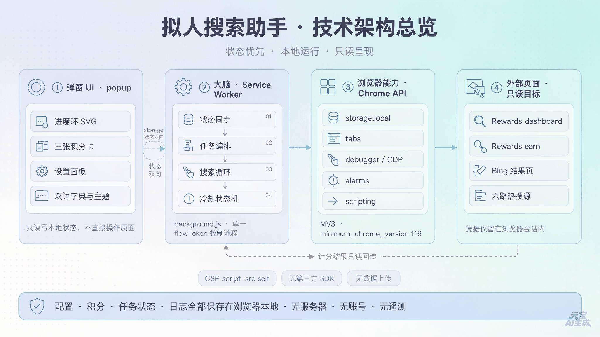
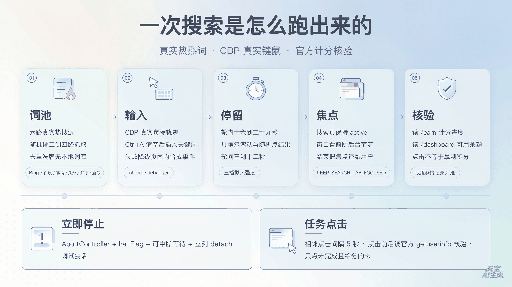
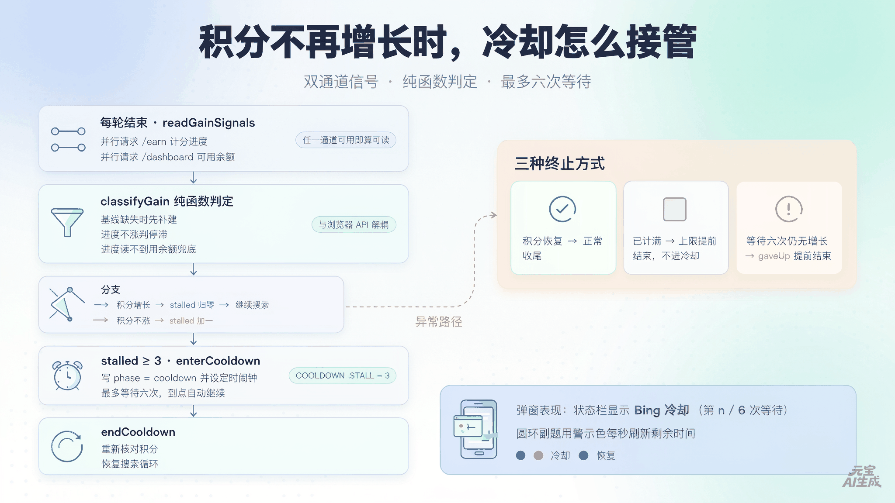
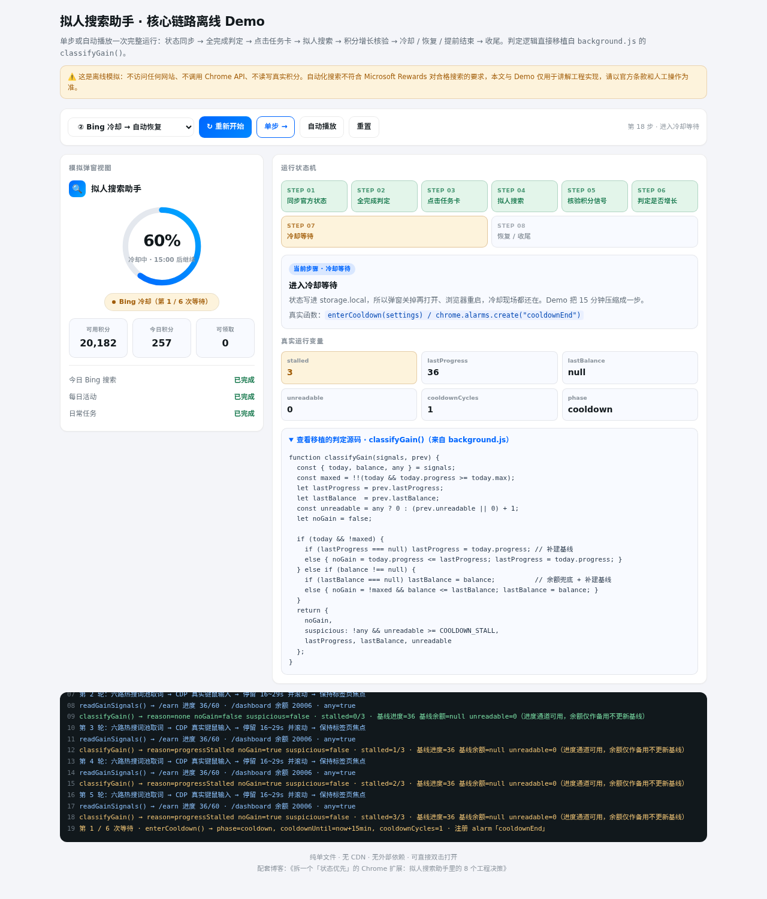

# 拆一个「状态优先」的 Chrome 扩展：拟人搜索助手里的 8 个工程决策

> 本文只做代码层面的工程拆解。它是一个非官方的本地工具，用于查看 Microsoft Rewards 的今日进度并减少重复点击；**自动化搜索不符合 Rewards 对「合格搜索」的要求**，可能导致不计分或账户受限。文中所有自动化相关描述都只是为了说明实现原理，不建议用于获取积分。请以官方条款和人工操作为准。

打开 `chrome://extensions` 加载这个插件，你会看到一个 380px 宽的弹窗：一个进度环、三张积分卡、一个按钮、一列今日任务。看上去像个很轻的看板。

但把 `background.js` 摊开，里面有五千多行代码：CDP 真实键鼠、六路热搜抓取、RSC payload 解析、可中断的长任务、冷却状态机、标签页焦点编排、分钟级定时调度……一个小弹窗背后，几乎是一整套「浏览器内自动化运行时」。

这篇博客不列功能清单，只聊我在代码里看到的**取舍**：它为了「先看清状态，再决定要不要动手」，在工程上做了哪些不太常规的决定，以及这些决定是怎么落地的。文末配了一个可离线运行的 demo，把核心链路拆给你看。

---

## 一、8 个技术亮点

| # | 亮点 | 落在哪 |
|---|---|---|
| 1 | MV3 service worker 里跑长任务，用「分片等待 + 定时闹钟」续命 | `nap()` / `chrome.alarms` |
| 2 | 状态优先：每次动手前先同步官方状态，全完成则**零动作**返回 | `runAutoComplete()` |
| 3 | 真实 DOM 解析：解 RSC flight payload 的转义文本，双通道取积分 | `decodePayload()` / `cardsPoints()` |
| 4 | CDP 真实键鼠 + 贝塞尔轨迹，失败才降级合成事件 | `humanClickPlan()` / `cdpInsertText()` |
| 5 | 六路真实热搜词池，明确拒绝本地词库 | `HOT_SOURCE_FNS` / `getKeywordPool()` |
| 6 | 双通道积分增长信号 + 纯函数冷却状态机 | `readGainSignals()` / `classifyGain()` |
| 7 | 标签页焦点与生命周期编排（防后台节流、结束还焦点） | `KEEP_SEARCH_TAB_FOCUSED` 等 |
| 8 | 立即停止：`AbortController` + 可中断等待 + 立即 detach | `haltRun()` / `nap()` |

弹窗侧还有几个小而讲究的东西：SVG 进度环的 `stroke-dashoffset` 动画、逐位滚动的 odometer 数字、`document.startViewTransition()` 主题切换、跟随系统语言的双语字典、以及鼠标悬浮时绕圈旋转的光环。它们不改变功能，但决定了「打开就知道今天还剩什么」这句产品话能不能成立。

---

## 二、架构：四层，单向调用，只读回传



整套东西分成四层：

- **弹窗 UI**（`popup.html` / `popup.js` / `popup.css`）：只读写 `chrome.storage.local`，从不直接操作网页。
- **Service Worker**（`background.js`）：唯一的大脑。状态同步、任务编排、搜索循环、冷却状态机都在这里，用一个 `flowToken` 判断「这次运行是不是已经作废」。
- **Chrome API 层**：`storage.local` 存状态，`tabs` 管页面，`debugger` 发 CDP 输入，`alarms` 做定时，`scripting` 做注入兜底。
- **外部页面**：`rewards.bing.com/dashboard`、`/earn`、Bing 结果页、六路热搜源。只被读取，登录凭据始终留在浏览器会话里。

这个分层最值得说的是**数据方向**：弹窗和后台之间靠 storage 双向同步，后台到页面是单向调用，页面回来的是「只读的计分结果」。所以弹窗被关掉、被重新打开、甚至浏览器睡一觉醒来，后台都能从 storage 恢复现场，而弹窗永远只是个视图。

`manifest.json` 也印证了这个思路：`content_security_policy` 写死 `script-src 'self'; object-src 'none'`，没有远程脚本；`minimum_chrome_version` 定在 116，因为要用 view transition 和较新的 MV3 行为。权限表里最扎眼的是 `debugger`——它是后面所有「真实键鼠」的前提，也是这个插件能力上限的来源。

### 长任务怎么在 MV3 里活下来

MV3 的 service worker 会在空闲时被回收，而这里的搜索一轮要 16~29 秒，还要连跑几十轮。代码里的解法不是「保活 API」，而是让等待本身变成可中断的、会持续触碰 storage 的分片轮询：

```js
async function nap(ms, token) {
  const end = Date.now() + Math.max(0, Number(ms) || 0);
  while (Date.now() < end) {
    bail(token);                                   // 被停止 / 运行作废就抛 STOP
    await sleep(Math.min(800, Math.max(1, end - Date.now())));
    await load(['running']);                       // 分片触碰 storage，维持 SW 活跃
  }
  bail(token);
}
```

再配一个 `watchdog` 周期闹钟和 `resumeIfNeeded()`：浏览器重启后，如果 `running` 还是 true，就按 `phase` 从 `fetchingStartPoints` / `checkingLimit` / `searching` / `cooldown` 接着跑。超过 30 分钟没有活动痕迹则判定为「被中断」，直接报错让用户重新点开始，而不是拿昨天的积分基线偷偷开跑。

---

## 三、核心原理一：一次搜索是怎么跑出来的



### 1. 关键词不编，只从真实热搜抓

`HOT_SOURCE_FNS` 里是六个抓取函数：Bing 趋势、百度热搜、微博、今日头条、知乎、新浪 RSS。`getKeywordPool()` 每次随机挑 2~4 个源并发抓取，清洗、去重、洗牌，再截成词池。**任何一个源都抓不到就明确报错**，注释里写得很直白：不使用本地词库。

这比「内置 100 个英文单词随机拼」诚实得多，也避免了词库重复带来的模式化。相关延伸则走当前 SERP 的「相关搜索」链接 → Bing autosuggest → 热搜词回退，同样不凭空造词。

### 2. 输入走 CDP，不是 `element.value = ...`

```js
const plan = humanClickPlan(box.box, lastXY, runLevel);  // 贝塞尔轨迹 + 过冲
if (realInput) {
  await cdpClickPlan(tabId, plan);      // 真鼠标移动到搜索框
  await cdpClearInput(tabId);          // Ctrl+A → Backspace
  await cdpInsertText(tabId, keyword); // Input.insertText
  await cdpKey(tabId, 'Enter');        // 真键盘回车
} else {
  /* 降级：页面内合成事件序列 */
}
```

`HUMAN_PROFILES` 用三档强度控制轨迹步数、过冲概率、滚动屏数、每轮时长倍率：低档 4~10 步、不过冲；高档 24~52 步、40% 过冲。每轮还按概率混合「粘贴关键词 / 直接改词」「回首页 / 留在结果页」「点开结果再返回」，轮内 16~29 秒、轮间 3~12 秒。

这里有个很实际的坑：后台标签页会被浏览器节流，搜索会「看起来卡住」。所以 `KEEP_SEARCH_TAB_FOCUSED` 和 `FOCUS_WINDOW_TOO` 每轮把搜索页拉回 active、把窗口置前；`KEEP_TASK_TABS` 让任务阶段弹出的标签页保留不关；`RESTORE_FOCUS_ON_FINISH` 在收尾时把焦点还给用户原来那个标签页。这是纯粹的工程经验，不写在功能列表里，但少了它整个流程在真机上跑不通。

### 3. 「点了」不等于「拿到分」

任务卡片识别走的是真实 DOM：以 `a[href]` 为入口，双通道取积分标签。Next.js 的 RSC flight payload 里类名字符串是转义过的（`\"className\":\"text-labelControl\"`），所以先 `decodePayload()` 再按「标签 → 相邻数值」配对解析。`/dashboard` 和 `/earn` 两页逐页独立扫描，同名卡片用页面内序号区分，不跨页去重。

点击前后还会调官方 `/api/getuserinfo?type=1` 核验（`HUMAN_VERIFY_OFFICIAL`），只点「未完成且给分」的卡，把已完成、0 分、搜索进度条、连续打卡、兑换入口都跳过并逐条打印原因。这一步把「点击成功」和「服务端确认计分」显式分开了——**进度与积分一律以服务端记录为准**。

### 4. 停止要立刻生效

`haltFlag` 是全局急停标记，`runSignal` 是 `AbortController`。`haltRun()` 一被调用就 abort 并立刻 `cdpDetachAll()`，所有 `nap()` 分片都在下一次循环里 `bail(token)` 抛出 `STOP`。所以点「停止」不需要等当前那 20 秒的拟人停留走完。

---

## 四、核心原理二：积分不再增长时，冷却怎么接管



这是整套代码里最值得单独讲的一段，也是最容易写错的一段。

### 原来的坑

早期版本的积分停滞检测被一个启动期标记门控：

```js
if ((await load(['liveCheck'])).liveCheck) {
  const { today } = await directToday();
  // 只有拿到 today 才判停滞
}
```

这会漏掉两类真实情况：**① 启动同步走的是注入兜底而不是官方直连，`liveCheck` 为 false，整块检测被跳过**；**② 首轮没读到进度，`lastProgress` 一直是 null，`noGain` 永远算不出来**。结果就是 Bing 已经停止计分了，插件还在老老实实空跑几十轮。

### 现在的做法：双通道信号 + 纯函数判定

每轮搜索结束后，不再看启动标记，而是**直接并行读两个官方信号**：

```js
async function readGainSignals() {
  const [todayRes, balRes] = await Promise.all([directToday(), directPoints()]);
  const today   = todayRes.today || null;                     // /earn 搜索计分进度
  const balance = balRes.points !== null ? balRes.points : null; // /dashboard 可用余额
  return { today, balance, activities: todayRes.activities, any: !!(today || balance !== null) };
}
```

判定逻辑抽成一个**不依赖任何 Chrome API 的纯函数**，这也是它能被单独测试、被搬进 demo 的原因：

```js
function classifyGain(signals, prev) {
  const { today, balance, any } = signals;
  const maxed = !!(today && today.progress >= today.max);
  let { lastProgress, lastBalance } = prev;
  const unreadable = any ? 0 : (prev.unreadable || 0) + 1;
  let noGain = false;

  if (today && !maxed) {
    if (lastProgress === null) lastProgress = today.progress; // 补建基线，本轮不计停滞
    else { noGain = today.progress <= lastProgress; lastProgress = today.progress; }
  } else if (balance !== null) {
    if (lastBalance === null) lastBalance = balance;         // 余额同样补建基线
    else { noGain = !maxed && balance <= lastBalance; lastBalance = balance; }
  }
  return {
    noGain,
    suspicious: !any && unreadable >= COOLDOWN_STALL,
    lastProgress, lastBalance, unreadable
  };
}
```

四个关键决定：

1. **基线可以运行中补建**：启动时拿到的 `todayStart` / `startPoints` 是初值，拿不到就等第一轮信号补上，且补建那轮不算「没涨」，避免误判。
2. **进度读不到就用余额兜底**：`liveCheck=false` 不再等于「放弃检测」。
3. **两个通道都读不到，按疑似冷却累计**：`unreadable` 连续 3 轮就把 `stalled` 拉到阈值。因为「完全读不到」和「确实不计分」对用户而言是同一种结果——继续空跑没有意义。
4. **已计满不进冷却**：`maxed` 直接交给上限提前结束逻辑，避免把「今天已经拿满分」误判成「Bing 坏了」。

主循环里只剩三行：

```js
stalled = g.noGain ? stalled + 1 : 0;
if (g.suspicious) stalled = COOLDOWN_STALL;
if (settings.cooldownAware && stalled >= COOLDOWN_STALL) {
  await enterCooldown(settings);   // COOLDOWN_STALL = 3
  return;
}
```

`enterCooldown()` 写 `phase: 'cooldown'` + `cooldownUntil` + `cooldownCycles`，并用 `chrome.alarms.create('cooldownEnd', { when })` 定时唤醒；到点 `endCooldown()` 把 phase 改回 `searching`，重新跑 `runFlow()` 再核对积分。等待上限 `MAX_COOLDOWNS = 6`，用尽仍无增长就写 `cooldownGaveUp` / `stoppedEarly` 明确提前收尾，不继续空跑。

弹窗侧对应地显示「Bing 冷却（第 n / 6 次等待）」，圆环副标题用警示色每秒刷新剩余时间。状态是存在 storage 里的，所以弹窗关掉再打开、浏览器重启，冷却现场都还在。

---

## 五、配套 Demo：把核心链路拆开看

打开 `demo.html`（纯单文件、无 CDN、无依赖，双击即可运行），你会看到一个模拟弹窗 + 一条状态机 + 一个日志台。

**它演示的是插件真正的核心链路**，不是重新画一遍 UI：

```
同步官方状态 → 判定是否全完成 → 点击待完成任务卡 → 拟人搜索
      → 每轮核验积分增长 → 冷却 / 恢复 / 提前结束 → 收尾
```

其中「积分增长判定」直接**移植了 `background.js` 里的 `classifyGain()` 源码**，页面上会实时显示 `stalled`、`lastProgress`、`lastBalance`、`unreadable`、`cooldownCycles` 这几个真实变量，右侧「原理」面板会告诉你当前这一步对应哪个真实函数。

下拉框里准备了 6 个场景，正好覆盖上面讲的每种边界：

| 场景 | 你会看到什么 |
|---|---|
| 正常计分 | 每轮 +3，`stalled` 始终归零，跑完正常收尾 |
| Bing 冷却 | 第 3 轮进度不再涨 → 触发等待 → 恢复后继续计分 |
| 持续冷却 | 每次恢复仍不涨 → 6 次等待用尽 → `gaveUp` 提前结束 |
| 官方数据不可读 | 进度与余额都读不到 → 按疑似冷却接管 |
| 任务全完成 | 同步完直接**零动作**返回，不开页不点击不搜索 |
| 搜索已计满 | 提前结束，不误触发冷却 |



上图定格在「Bing 冷却」场景的第 1 次等待：状态机高亮 STEP 07，`stalled=3` 被标黄，`phase=cooldown`，模拟弹窗显示「Bing 冷却（第 1 / 6 次等待）」与圆环倒计时，日志里能一路看到 `readGainSignals()` 的读数、`classifyGain()` 的判定原因，以及 `enterCooldown()` 写入的字段。右侧还展开了移植过来的判定源码，可以直接对照着读。

支持「单步」和「自动播放」。建议先用单步走一遍「Bing 冷却」，盯着 `stalled` 从 0 → 1 → 2 → 3 的那一刻，再切到「持续冷却」看 `gaveUp`。这比读代码快。

> Demo 是**离线模拟**：不访问任何网站、不调用任何 Chrome API、不读写积分。真实插件需要登录态、浏览器权限和第三方页面结构，二者不可互相替代。

---

## 六、几个值得抄走的工程习惯

- **把判定逻辑抽成纯函数**。`classifyGain()` 不碰 `chrome.*`，于是 10 组边界场景可以在 Node 里几毫秒跑完，不需要起浏览器。
- **用 storage 当唯一事实源**。弹窗只是视图，后台可恢复，冷却可跨重启，全靠一个共享状态对象。
- **不要把「拿不到数据」当成「没问题」**。这里明确把「读不到」按疑似冷却处理，宁可等，也不空跑。
- **长等待必须可中断**。`nap()` 分片 + `bail(token)`，让「停止」是即时的而不是「等这轮跑完」。
- **区分「动作成功」和「结果达成」**。点击卡片要再核验官方计分，搜索要再看积分是否真涨。
- **边界写进 UI**。冷却轮次、倒计时、提前结束原因都直接显示，不藏进 console。

---

## 七、边界与局限

- 页面结构、第三方接口或服务规则一变，解析与点击就可能失效；弹窗状态不能作为任务完成的唯一依据。
- 官方接口与 DOM 解析都可能拿不到数据，代码里到处是兜底与降级，但兜底不等于准确。
- 单元测试与这个离线 demo 都**不能替代**真实浏览器、登录态与第三方页面上的端到端验证。
- 所有配置、积分历史、任务状态与日志都留在 `chrome.storage.local`；登录态与 Cookie 属于敏感会话凭证，不要贴进 Issue 或公开仓库。

---

## 小结

这个插件最打动我的不是「拟人搜索」这套花活，而是它处处把**状态**放在**动作**前面：先同步、再判定、全完成就零动作；点了卡还要核验计分；积分不涨就停下来等，而不是继续刷。把「不知道」也当成一种需要显式处理的状态，是这段代码里最成熟的工程判断。

技术博客写完了，插图与 demo 都在同一个目录里。

---

*配套文件：`demo.html`（离线演示）、`assets/` 下四张插图（架构总览 / 搜索链路 / 冷却状态机 / Demo 运行截图）、`README.md`*
