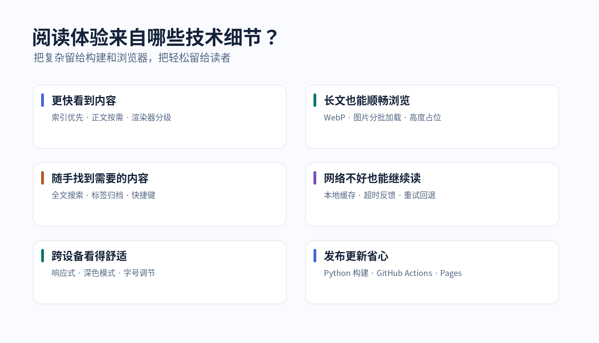
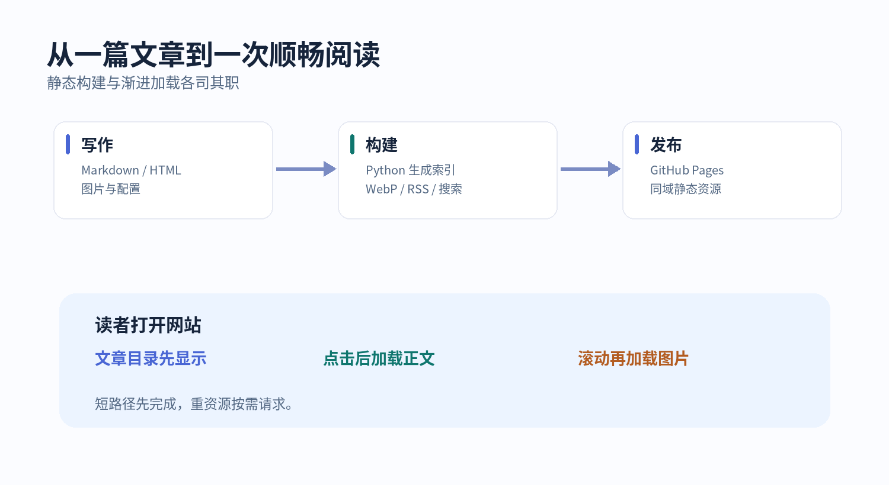
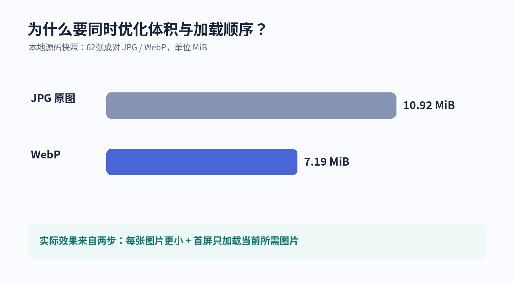

# 本网站的技术亮点

一座个人博客，最重要的应该是文字与阅读，而不是让访问者等待、忍受弹跳的排版，或者为了找到一篇文章反复翻页。

[本站 Khtao Blog](https://khtao.github.io/#/) 的技术选择始终围绕一个简单的目标：**让读者尽快看到内容、舒适地读完文章，并且在设备不同、网络不稳定的时候，依然能够顺利使用。** 与此同时，写作者发布和维护内容也应该足够轻松。

这篇文章结合网站的 `index.html`、`config.json`、Python 构建脚本及 GitHub Actions 工作流，介绍这些体验是怎样一点点实现的。这里展示的是关键实现思路；部分代码做了少量节选，完整行为以[项目源码](https://github.com/khtao/khtao.github.io)为准。



## 01｜架构做减法：不把写作变成工程项目

本站部署在 GitHub Pages，核心页面是 `index.html`，站点信息写在 `config.json`，文章放在 `blog/`。前端没有强制依赖大型运行时框架，也不需要单独维护博客数据库。

对于作者而言，常见的发布流程很简单：在 `blog/` 里写一篇 Markdown 或 HTML，提交到 GitHub，GitHub Actions 负责整理内容并完成部署。对读者而言，访问的则是一组已经准备好的静态文件。

```text
index.html                # 界面、主题、导航与文章阅读器
config.json               # 站点名称、作者、项目、版权等配置
blog/                     # Markdown / HTML 文章与图片
blog/index.json           # 自动生成的文章目录
blog/search-index.json    # 独立生成的全文搜索索引
scripts/                  # 元数据提取、图片优化、索引构建
assets/vendor/            # 本地托管的 Markdown / 代码高亮脚本
.github/workflows/        # GitHub Actions 自动发布
```

这种架构的好处不只是“文件少”。**构建工作发生在发布阶段，而不是让每一位读者打开页面时再做一遍。** 文章目录、摘要和检索数据在构建时就整理好了，浏览器只需要读取它们。



## 02｜自动整理内容：标题、日期和摘要不用重复填写

发布一篇文章时，作者可以写可选的 Front Matter，标注分类与标签；不写也能正常发布。

```yaml
---
category: 技术
tags: [GitHub Pages, 阅读体验]
---

# 一篇新的文章

这里开始写正文。
```

`scripts/build_index.py` 会扫描文章文件，提取标题、摘要、分类、标签，并根据 Git 提交历史获取创建和更新日期；对缺少头信息的文章，配套的 `infer_meta.py` 还会尝试推断合适的元数据。构建结果是结构化的 JSON，而不是依赖访客现场遍历 GitHub 仓库。

```python
# scripts/build_index.py 中的核心思路（节选）
EXT = {'.md', '.markdown', '.htm', '.html'}
# 扫描文章 → 解析内容与 Git 历史 → 生成 index.json
```

这使首页上的标题、日期和摘要能够保持统一。文章被修改、删除或全部清空时，下一次构建也会同步更新目录；**空目录被视为正常状态，而不是报错。**

## 03｜首页只拿目录：想读哪篇，再加载哪篇

加载性能最关键的设计之一，是**不让首页为用户尚未阅读的正文买单**。

`blog/index.json` 已经包含文章卡片所需的标题、摘要、日期和标签。首页先使用这些轻量数据完成展示；只有点击文章后，才读取相应 Markdown 正文或进入 HTML 阅读模式。

```javascript
// index.html 中的两种请求策略（节选）
const indexURL = './blog/index.json?v=' + Date.now();
const indexText = await getLocalText(indexURL, 10000); // 默认 no-store

// 打开具体文章时，才获取带内容指纹的正文
const articleURL = localRepoUrl(post.path)
  + '?v=' + encodeURIComponent(post.sha || 'current');
const body = await getLocalText(articleURL, 20000, 'default');
```

这一区分同时兼顾“及时更新”和“减少重复下载”：文章目录优先保持新鲜，正文没有变化时可以利用浏览器 HTTP 缓存。

Markdown 渲染器 `marked` 和代码高亮器 `highlight.js` 也放在本站的 `assets/vendor/` 下，减少对第三方 CDN 的依赖。正文先保证可读，代码高亮则尽量安排在浏览器空闲时补上；即使 Markdown 渲染脚本加载失败，页面还准备了简化的降级解析器。

## 04｜双格式阅读：Markdown 清爽，HTML 保留原貌

本站同时支持 Markdown 和 HTML 文章，这并非简单地给 HTML 加一段 `innerHTML`。

Markdown 由博客统一控制字体、行距、代码块和目录。HTML 则通过 **iframe 独立渲染**，尽可能保留原文的布局、样式和交互，避免一篇旅行攻略自带的 CSS 把整个博客界面改乱。

但 iframe 带来新的阅读工程问题：高度需要跟随正文变化，目录跳转需要识别文章内部位置，站内链接需要回到博客路由，图片也不能因为 iframe 的高度被扩展而一次性加载。

因此，阅读器为 HTML 做了专门处理：初始化时测量内容高度、监听变化、建立文章目录、接管图片加载，并保留**独立打开原始 HTML** 的入口。当文章文件暂时不可用时，页面会显示清楚的状态和重试操作，而不是只留下空白区域。

## 05｜图文长文章：WebP、占位和真正的按需加载

长图文是本站最值得花力气的部分。大图片不仅会消耗流量，还会与正文争抢网络连接；图片尺寸未知时，加载完成还可能挤动正在阅读的文字。

第一步是在构建阶段提取 HTML 中的 Base64 内嵌图片，让每张图片独立成文件。此前一篇游记的 HTML 正文约为 **2.76 MB**，拆离内嵌图片后正文约 **43 KB**。这不是删除图片，而是让图片可以单独缓存、转码和按需请求。

第二步是由 `scripts/optimize_images.py` 为 JPG/PNG 生成 WebP 对应文件，过大的图片按最长边限制缩放，并用内容 SHA-256 和参数版本避免无意义的重复处理。



在一次本地源码快照中，同名成对的 **62 张 JPG 合计约 10.92 MiB，对应 WebP 约 7.19 MiB**。这些是磁盘文件大小对比，而不是线上首屏实际流量；访问者通常只需要下载当前可见的几张图片。

第三步专门针对 iframe：对于远离首屏的图片，构建脚本先暂存真实地址，而不让浏览器解析 HTML 时立刻开始请求。

```html
<!-- HTML 长图文中，非首屏图片的处理方式（示意） -->

```

外层阅读器根据真实滚动位置释放这些地址；独立打开 HTML 时，文章自身还有备用的滚动加载机制。优先请求 WebP，失败时回退原始图片。宽高预留和 `decoding="async"` 则用于降低加载过程中的布局干扰。

一句话总结：**压缩解决“每张有多大”，懒加载解决“现在需不需要”。两者必须配合。**

## 06｜缓存与弱网：页面不是每次都从零开始

访客可能在地铁、酒店 Wi-Fi 或不稳定的移动网络下打开本站。为此，缓存不仅是一项速度优化，也是体验上的容错设计。

文章目录会保存在浏览器 `localStorage` 中，回访时先展示已有内容，再尝试同步最新索引。正文依据内容指纹复用 HTTP 缓存；搜索索引则独立缓存，避免首页每次都下载。

源码也考虑了浏览器存储配额：缓存写不下时，优先放弃正文副本、保留目录元数据；再失败也不会影响在线加载。

```javascript
// 缓存策略的关键降级路径（根据 writeCache 节选）
if (full.length <= LIMIT && safeStore.set(CACHE_KEY, full)) return;
if (metaOnly.length <= LIMIT && safeStore.set(CACHE_KEY, metaOnly)) return;
safeStore.del(CACHE_KEY);
```

网络失败时，页面会尽量保留上次拿到的文章列表，给出“重新加载”入口；文章正文和 HTML iframe 也有超时反馈与重新尝试的路径。

更细的一点是：**后台更新如果没有改变文章版本，不要重建当前阅读页面。** 否则 iframe 会重新载入，读者的滚动位置可能被重置。源码通过文章名称、SHA 和索引版本形成签名，判断是否真的有必要重绘。

当然，这不意味着离线时所有文章都一定可读：从未访问过的正文和图片，仍然可能需要联网获取。

## 07｜搜索和导航：让内容积累之后依然找得到

当博客文章增加后，“找到一篇旧文”会比“打开首页”更重要。

本站提供首页搜索、按年归档、分类与标签合并的话题页、发布时间与更新时间排序，以及文章之间的相关链接。搜索不止匹配标题：`blog/search-index.json` 提供正文检索所需文本，**只有读者开始搜索时才请求**，不占用首页的首批带宽。

搜索支持 `Ctrl/⌘ + K` 和 `/` 快捷键，也保留普通输入框，避免把功能做成只能靠鼠标或只能靠键盘使用。

项目页面另有 GitHub 仓库展示：构建时生成 `projects.json` 快照，在可用时由静态资源提供数据；必要时再尝试客户端刷新。项目展示与文章目录分开，**不会让博客文章依赖 GitHub API 才能打开**。

## 08｜阅读细节：不是所有优化都能换算成毫秒

有些优化体现在网络瀑布图里，另一些只体现在读者是否愿意把长文读完。

本站统一控制 Markdown 阅读宽度，避免宽屏上一行文字拉得太长；移动端自动压缩页面边距，侧边目录转为折叠式目录。长文章配有阅读进度条、章节跳转、回到顶部和字号调节；代码块支持语法高亮与一键复制，图片支持放大查看。

深浅主题通过 CSS 变量集中管理，并尊重系统的颜色偏好；读者选择的主题与字号会被保存。触屏与小屏幕布局单独优化，表格和代码块允许横向滚动，而不是把整篇文章撑出屏幕。

无障碍方面，源码加入了键盘焦点样式、部分按钮的 `aria-label`、跳转主要内容的链接，以及 `prefers-reduced-motion` 动画减弱规则。阅读进度条使用 `transform: scaleX(...)`，也避免了用宽度变化反复触发布局。

这些设计仍然需要持续进行屏幕阅读器和真实设备测试，但其目标很明确：**把读者的注意力还给正文。**

## 09｜项目、学术与个人主页：内容之外保持联系

博客除了文章，还有“我正在做什么”。本站用项目卡片展示 GitHub 仓库的名称、描述、语言、星标等信息，并支持语言筛选和精选项目；配置中还留有学术主页入口，可以链接 Google Scholar。

这些功能采用可配置的思路：站点所有者可以在 `config.json` 中决定是否开启项目页、哪些仓库置顶、哪些仓库排除，学术数据也允许留空，而不是为了填满卡片而生成不可靠的数字。

访客看到的是有组织的内容，而维护者不必为每个展示模块另建一个后台系统。

## 10｜自动发布与可维护性：让更新可靠发生

`.github/workflows/blog-index.yml` 将内容提交转换为一条清晰的构建流程：提取内嵌图片、生成 WebP、测量图片尺寸、准备 HTML 懒加载、构建文章目录与搜索索引、生成 RSS 与站点地图，再把网站打包发布到 GitHub Pages。

```yaml
# 工作流中的核心步骤名称（节选）
- name: Extract inline base64 images out of articles
- name: Optimize images (WebP twins + recompress)
- name: Measure image intrinsic sizes (for instant iframe height)
- name: Stage offscreen HTML pictures before parsing
- name: Build index from article files and git history
- name: Upload website and fresh index in one artifact
- name: Publish GitHub Pages
```

索引和网站文件在**同一次部署**中发布，减少“页面已更新但文章目录还是旧的”这类不一致。构建脚本还尽量保持幂等，重复执行不会把 HTML 注入脚本一层层叠加。

访客不需要知道这些自动化存在，但它们能减少维护失误带来的体验问题。

## 11｜版权、订阅与开放边界

为了让内容有明确的来源，文章末尾提供作者、标题、原文链接与许可声明；当读者复制较长的正文时，网页可以自动附上出处，短摘引和输入框中的复制则尽量不受干扰。

RSS 便于读者使用自己喜欢的阅读器订阅更新；站点地图、结构化数据和 `robots.txt` 用来向搜索引擎说明网站内容和抓取偏好。

这里也有必要讲清楚边界：`robots.txt` 是协作规范，不是技术防火墙；版权提示不能阻止所有恶意转载。另外，目前的文章路径主要采用 `#/p/...` 哈希路由，**没有为每篇文章提供独立的服务端 SEO 页面**，所以搜索引擎收录能力存在天然限制。

技术亮点不意味着没有取舍。对这座个人博客来说，低维护成本、统一阅读体验和可靠的内容交付，是更优先的选择。

## 写在最后｜好的技术，应该让人感觉不到技术

回头看这套方案，会发现最重要的并不是某一个框架或压缩参数，而是几条贯穿始终的原则：

- **先显示读者需要的内容**：目录、正文、远处图片有各自的加载时机。
- **优先复用已经做过的工作**：构建阶段提取元数据，回访利用缓存，图片转换避免重复。
- **为不理想的环境保留退路**：WebP 有原图回退、网络错误可重试、渲染脚本有降级方案。
- **让阅读而不是界面占据中心**：目录、字号、配色、进度提示与移动端布局都为正文服务。
- **保持维护路径简单且透明**：文章以文件存储，代码公开，更新由 Actions 完成。

一个博客真正值得打磨的，不只是第一次打开时有多惊艳，而是**读者第二次、第五次、在手机上、在弱网中来到这里时，仍然愿意安静地读下去。**

---

**源代码：** [GitHub · khtao/khtao.github.io](https://github.com/khtao/khtao.github.io) · **访问网站：** [Khtao Blog](https://khtao.github.io/#/)

