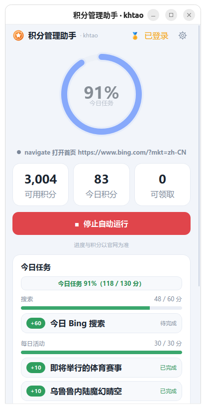
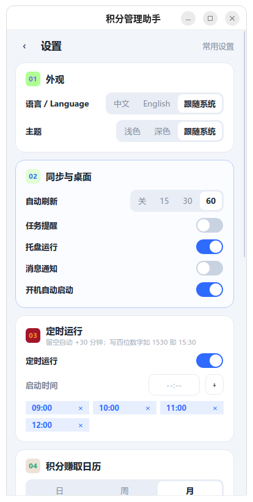

# 积分管理助手

> 独立开发、非官方的桌面小工具。文中提到的 Microsoft、Bing、Microsoft Edge 与 Microsoft Rewards 仅用于说明兼容环境，相关商标归其权利人所有。

早上开电脑，先开浏览器、登录、翻到积分页看看今天还剩什么；点开几张活动卡片，顺手搜几轮；晚上想起来再回去瞄一眼分数。第二天，原样再来一遍。

这事一点都不难，只是特别碎。忘了就是忘了，官网不会替你补；想查「上周三我到底拿了多少分」，页面更不会替你记着。

**积分活动管理助手 2.1** 就是为这些碎动作做的。装好之后它待在托盘里，主页一个圆环、一个大按钮。想省事的时候点一下，今天没做完的那几项会自己走完。

这篇只聊两件用起来最有感觉的事：**一键把重复劳动交出去**，以及**那条把「像真人一样搜索」做得有点较真的实验性功能**。不想看长文，直接拉到最后「三分钟装好」。

| 主页 | 运行中的样子 | 深色主题 |
| --- | --- | --- |
|  |  |  |

---

## 一、自动完成任务：从「我来点」变成「它顺手做完」

以前我给这件事留了固定的一段时间，现在只剩一个动作：**点一下**。

主页的大按钮和托盘菜单里是同一件事。点下去，它先看一眼官方状态，只挑今天还没完成的，已经做完的直接跳过，绝不做无用功。跑完分数自己就更新了，不用再去点一下刷新。

想连点一下都省掉，就在设置里挑时间点——最多十个，早上出门前放一个，午休放一个，晚饭后放一个。到点自己开始，当天全部做完会安静跳过，不会白跑一趟，也不会半夜把浏览器弹出来吓你一跳。一天里哪个时段该动、哪个时段该歇，都随你排。

一轮的顺序很自然：先依次点开还没完成的活动卡片，接着把还差的电脑端搜索补上。想中途叫停也随时可以：运行的时候主按钮变成红色的「停止」，同步入口同时锁住，不会出现一边跑、一边被刷新把状态冲掉的混乱。全部做完之后它会安静下来，可以设成完成后休眠，第二天跨天自动恢复托盘。

还有个顺手的小地方：**可领取积分**。真有可领取时，那张卡会变成「点击领取」，打开的一定是当前这个账号的官网页面，多账号也不会串到别的号。本人在网页上领完、关掉窗口，分数会自己刷新；万一关窗没被察觉，过一会儿也会补刷一次，不会一直停在旧数字上。

说白了，它替掉的不是「思考」，是那些每天一模一样、点开、等待、关掉、再点开的动作。

---

## 二、拟人搜索：把「像人」拆成了几十个小细节

这一节是我在整个项目里最喜欢的部分，因为它较真到有点好笑。

如果只是每隔几秒提交一个词，那不叫搜索，那叫打卡。真人的一次搜索是一串不整齐的动作：想到个问题、把词打进去、扫一眼结果、往下滚两屏、忽然往回翻一下、犹豫半秒才点开一条……这条实验性功能把这些都拆开做了一遍。

**搜什么：词是活的。**

不是固定一批词反复用。每天从实时热搜榜取材，再把干巴巴的热词改写成真人会打进搜索框的样子：有时是「这是什么意思」「怎么关闭」这样的问句，有时越搜越长、顺手加上限定，有时围绕同一个话题连着几次逐步收窄、或者换个角度再搜——像人真的在琢磨一件事，而不是把榜单念一遍。你也可以只填自己想搜的词，把热搜整个关掉。

**什么时候搜：没有一处整齐的节拍。**

每一轮花多久、两轮之间隔多久，都是随机取样，精确到毫秒，没有任何一处写死的等待；整轮有硬上限，时间到了就收手，不会拖着不走。停顿也不是那种一眼看穿的均匀随机：偶尔会「走神」多愣半秒到一秒多。更妙的是它按**你所在地的时间**给节奏——深夜整体慢下来，上午更利落，午后平缓，不是照着服务器时钟走。这些节奏不是拍脑袋写的「随机数」，而是照着真人行为里常见的分布取样，再叠上一点缓慢漂移和粉噪般的起伏——所以连着看十轮，也找不到两轮一样的节拍。

**怎么动：鼠标不是瞬移的。**

移动走的是带轻微手抖的曲线，两头慢、中间快，偶尔还会冲过头一点再拉回来，像人瞄不准；点击落在按钮里的随机位置，不会每次都点正中心，按下到松开之间也各有长短。读页面时鼠标会无目的地游走几下，滚动是一段一段的，中间停顿，偶尔往回翻一眼；输入是整段粘进去，偶尔还会像人一样回头改一下。

**在哪搜：环境得自洽。**

出口地址对应的时区、浏览器语言、搜索市场、当地作息会统一起来，不出现「人在广州、浏览器却是纽约时间」这种一眼就别扭的组合。它还会自己核对时区、语言、浏览器特征、请求头有没有互相打架，有冲突就在报告里列出来。

每一轮用一份全新的空配置启动，登录态从本机加密凭证注入，完全不碰你日常那个浏览器、不抢它的配置目录——你该看什么看什么，它在旁边安静跑完自己的。

**想多细，自己挑。**

强度有三档：轻快、日常、慢而细。同一个随机种子能把一整轮完整复现，想复盘也说得清。每一轮用了多久、点了哪条结果、有没有命中，都会记进报告里。

把这些细节堆在一起，目的不是「骗过谁」，而是让这条实验性功能在行为层面尽量接近一次真实使用。做的人显然是把「人到底是怎么用搜索的」认真拆过一遍，才动手写的。

---

## 三、顺带一提，看板本身也没偷懒

- **不写假的零分**：三项积分取页面显示值；读不到就老实写「不知道」，绝不填一个看起来很确定、其实是编的数字。
- **一个圆环就是全部入口**：显示今日进度，也是唯一的手动刷新入口。鼠标停上去会轻轻呼吸，圆环里的小字变成「点击刷新」，不用弹悬浮提示。
- **积分日历只画有分的日子**：没记录的日子干脆不占位。日、周、月三种视图，汇总跟着切成日均、周均、月均，不会出现切到月视图还在算日均的错位。
- **看着舒服**：浅色、深色、跟随系统，中文、英文，动画常开；整款应用不用鼠标悬浮提示，说明一律写在界面上。

数据全在本机，卸载不删历史。日志分两层：平时是清爽的日常流水，真出问题时另有一份带完整错误堆栈的排查记录；导出的日志包和网页快照包文件名自带日期时间，连着导几次也不会互相覆盖。

---

## 四、三分钟装好

**最省事的路**：去项目的 Releases 页面，按系统下载安装包。

- **Windows**：双击，向导界面跟随系统语言（中文或英文），可选装给所有用户；升级时先卸旧版但保留你的数据；装完勾一下就能直接打开，桌面和开始菜单图标也会建好。
- **Ubuntu / Debian**：下载安装包双击，让系统顺手补齐图形运行库。
- **macOS**：打开安装包，把图标拖进应用程序。
- 想从源码跑也行：装好 Python 和 Edge，按仓库说明准备环境再启动，运行时依赖只有三个。

**装好之后只做一次的事**：在设置里点「打开浏览器登录」，在弹出的 Edge 窗口里由你本人完成登录和二次验证，回来点「我已完成登录」。应用不代填密码，那个窗口也不会自己关掉，慢慢来就行。

**然后就没有然后了**：点一下圆环同步，或者直接在托盘点「自动完成任务」；想定时就在设置里挑几个时间点。

---

## 五、用之前，先说清楚

几句实话，不藏着：

- 独立开发、非官方，与 Microsoft 没有授权、赞助或认可关系。
- 平时的同步是**只读**的：不代填密码、不导出登录凭证、不自动领取积分。领取积分请本人在官网点。
- 自动完成任务与拟人搜索是**实验性辅助功能**。按 Microsoft Rewards 条款，奖励搜索应由用户本人手动进行，机器人或宏产生的搜索不属于合格搜索，使用后可能无法获得积分、积分作废或账户受限。请把它当作省事辅助和技术体验，**不要依赖它获取积分**，以人工操作和官方要求为准。

把边界写在明处，用起来反而踏实。

---

## 最后

我原本只是想少点几下，结果最留住我的反而是那些「没必要、但做得很细」的地方：鼠标冲过头会拉回来，深夜会自己慢下来，日历上没分的日子干脆不占位，读不到就承认不知道。

如果你也受够了每天那串一模一样的点开与关掉，又恰好对「机器怎么把一件事做得像人」有点好奇，值得装来试试。三分钟，之后基本不用管它。

项目当前版本 2.1。本文界面图均来自项目自带预览；更细的说明与安装包验证文档在仓库里。
